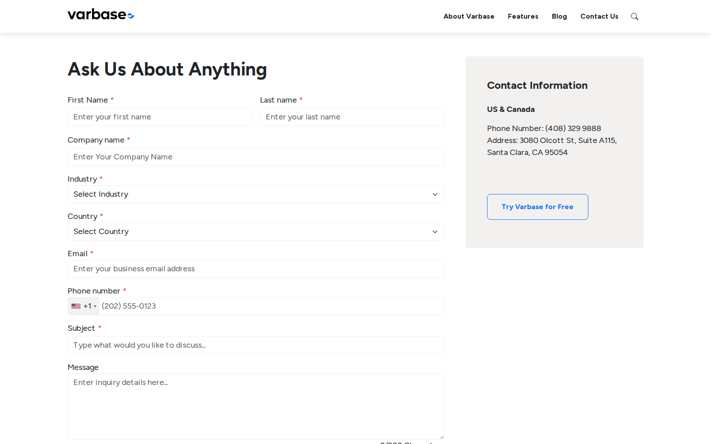
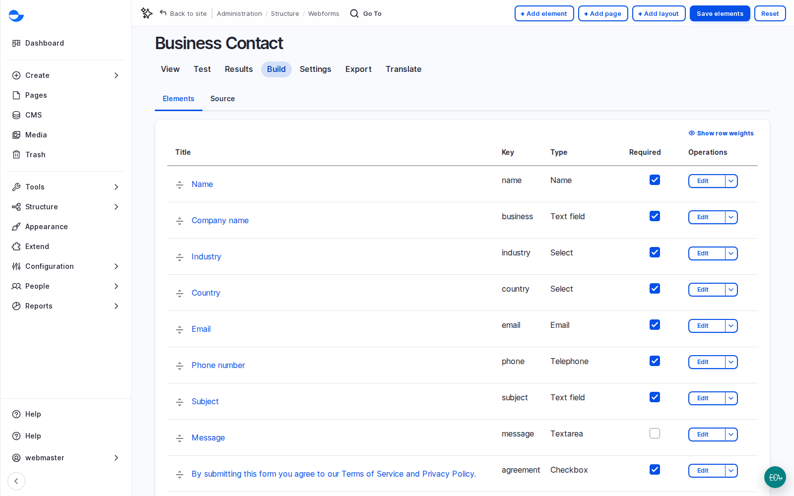

# Search, Forms and Email

Three features connect a site with its visitors: **search** helps them find content, **forms** let them speak to the organisation, and **email** carries messages both ways. Every site needs them and nobody wants to build them from scratch; Varbase ships all three ready.

<!-- TODO(lesson-17-video): when the unlisted upload exists, replace the hint block below with an embed block for its https://youtu.be/ link, captioned "Lesson 17: Search, Forms and Email (Video)". -->

**Lesson 17 video: coming soon.** It will appear here and in the [Varbase: Content Designers playlist](https://www.youtube.com/playlist?list=PLRf-g9-Bc-LI).


## What It Is

- **Site search** on **Search API**, with an index in the site's own database (no extra search server). The search page is a Drupal Canvas page with a search box, results and filters by tag, content type and date. See [Site Search](site-search.md).
- **Webform**: a form builder with conditions, validation, email handlers, submissions and export, plus ready templates (job application, registration, feedback and more). See [Webforms](webforms/).
- **Easy Email**: a branded template for every email the site sends, such as account activation and password recovery, with an email log. See [Email Templates](email-templates.md).

<figure><figcaption>
The Business Contact Form on the Contact Us Page
</figcaption></figure>

## Why It Matters

- Lead capture and sign-ups on day one, without code.
- What visitors type into search is one of the most honest sources of insight a site has.
- Account emails that look like the brand, in the visitor's language.

## Scenario: Launch a Form Properly

For every form, agree five facts with the client and test them:

1. **Fields**: only what the team will use. Every extra field costs answers, especially on phones.
2. **Who is notified**: an email handler for the organisation and, usually, a confirmation for the visitor. A form with no handler stores submissions and tells nobody.
3. **Where the data goes**: stored in the site, and perhaps sent to a customer database, newsletter service or ticket system (each connection needs setup and testing).
4. **How long it is kept**: Webform can delete old submissions after a set period. Agree it with the client's privacy officer.
5. **Which languages**: labels, help text, errors and the thank-you message, translated.

Then use the form's **Test** tab, submit it on a test site, check both emails in the test mailbox, and delete the test submissions. See [Create New Webform](webforms/create-new-webform.md) and [Setting up Email Handlers](webforms/setting-up-email-handlers.md).

<figure><figcaption>
The Business Contact Form in the Builder
</figcaption></figure>


On the course's demo site, the **Newsletter Subscribe** form had no email handler and no newsletter connection: sign-ups were stored, but nobody was told and no address reached a mailing list. Check every form for this before launch. An agreement checkbox that links to an unpublished privacy policy or a missing terms page is the same kind of gap.


## Questions Clients Ask

- **Can form data go to our CRM or newsletter tool?** Yes, with Webform handlers and connectors. Each connection is a line item: setup, testing and someone to own it.
- **Will search handle Arabic?** Search respects the page's language. Arabic has its own details, such as different forms of the same letter; test with real phrases.
- **Do editors get emails when something waits for review?** Not by default. They can be added with the site's automation tools (see [AI Agents, Answers and Automation](../ai-in-varbase/ai-agents-answers-and-automation.md)).

## Planning Notes

- Email delivery (a mail service or the organisation's mail server) is a hosting decision. The client's IT team must authorise the site to send on their domain, or emails land in spam.
- List every email the site can send, agree its wording and languages, and test each one before launch.
- For large or multilingual search, consider Solr or AI search. Assumption: database search suits most sites under tens of thousands of items.
- Agree retention and access for form submissions; they hold personal data.


**Check Yourself**

1. A new post does not appear in search. Where do you look first?
2. What can be missing from a newsletter form, and why does it matter?
3. Where would you check whether a password reset email was sent?

