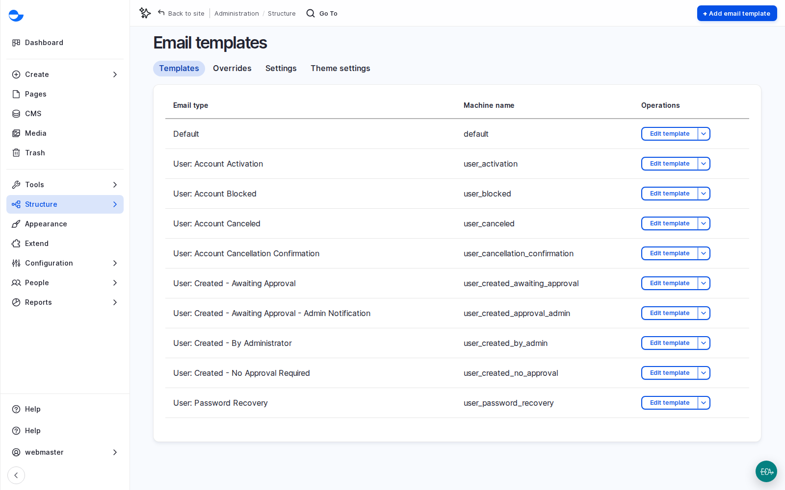

# Email Templates

A site sends more emails than people expect: account activation, password resets, account blocked or cancelled, form notifications and confirmations. Varbase manages them with **Easy Email**, which gives each type of email a branded template.

## The Templates

Go to **Structure** \ _**Email templates**_ (`/admin/structure/email-templates/templates`) to see them: **Default**, **User: Account Activation**, **User: Account Blocked**, **User: Account Canceled**, **User: Password Recovery**, the **User: Created** variants, and more.

<figure><figcaption>
Email Templates
</figcaption></figure>

## Editing a Template

1. Click **Edit template** next to an email type.
2. Edit the subject and the body like content. Placeholders insert details such as the person's name, the site name and the one-time link.
3. Write in the organisation's voice, and translate the template into each language: account emails follow the person's language.
4. Save, then trigger the email on a test site and check it in the test mailbox.

The **Overrides** tab makes emails from other parts of the site, such as forms or modules, use the same look and sending setup. The email theme, with the logo and colours, is separate from the website theme because email programs display design differently; include it in the brand work.

## Scenario: "I Never Got the Password Reset"

1. Open **Reports** \ _**Email log**_ (`/admin/reports/email`). It shows who each email was for, when it was created and sent, and whether it succeeded.
2. If it was sent, ask the person to check spam, and ask the client's IT team whether the domain authorises the site to send email.
3. If it was not sent, ask the development team to check the mail service on that server.

## Testing Safely

On development and staging sites, emails must never reach real people by accident. Those sites catch every outgoing email in a test mailbox. Test each email in each language there before launch.

## Planning Notes

- Choose the sending service and sender address, and have the client's IT team add the domain records that authorise the site to send.
- Ask the development team for a list of every email the site can send; agree wording and languages for each.
- Editor notifications, such as a post waiting for review, are not on by default; they can be added with the automation tools.
- Developers: see [Easy Email Recipes](../../developers/understanding-varbase/easy-email-recipes/).
