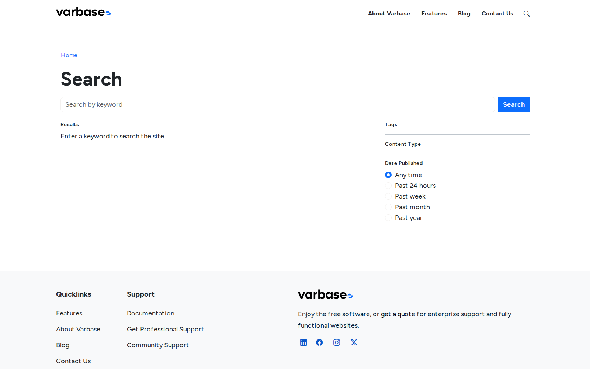
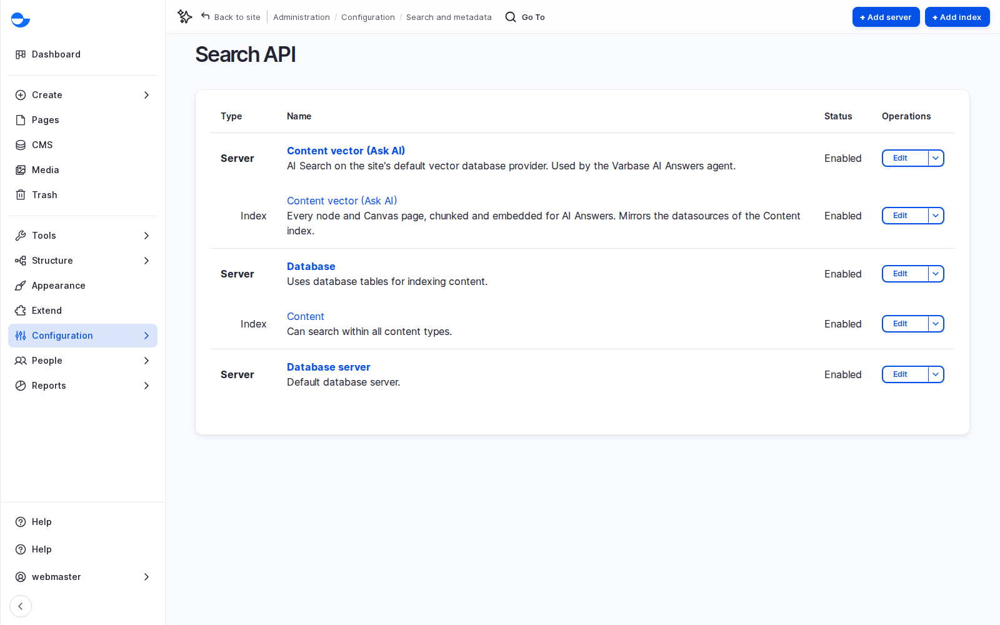

# Site Search

Not every visitor uses the menu; many go straight to search. Varbase ships a search page with filters, in every language, built on **Search API**. This page shows how it works for visitors and editors, and what to plan.

## Searching as a Visitor

The search control in the header opens a box, and results appear on the search page (`/search`). Each result shows the title, a short extract and the type of content. Filters on the side narrow results by **Tags**, **Content Type** and **Date Published**, and show only values that exist in the current results.

<figure><figcaption>
The Search Page and Its Filters
</figcaption></figure>

Search respects the language of the page: on the Arabic site it finds Arabic content.

## How It Works

- Content is copied into an **index** designed for fast searching. On a Varbase Starter site the index lives in the site's own database, the right choice for most sites.
- When content is published or changed, it is queued and the site's scheduled tasks (cron) update the index, usually within minutes. Administrators see indexing status under **Configuration** \ **Search and metadata** \ _**Search API**_ and can re-index after a large change, such as a migration.
- The search page is a Drupal Canvas page made of components: the search box, the results and each filter. Editors can add an introduction or reorder filters without a developer. See [Live Components](../building-pages-with-drupal-canvas/component-catalog/live-components.md).

<figure><figcaption>
Search Servers and Indexes
</figcaption></figure>

## Scenario: A New Post Does Not Appear in Search

1. Check the post is published. Site search shows only published content, as visitors see it; drafts are found in the content list filters instead.
2. Check **Search API Exclude** on the post's form is not ticked. It keeps an item out of site search (it does not affect outside search engines).
3. Wait for the scheduled tasks to run, or ask an administrator to check the index status.
4. If the problem continues, ask the development team to check cron on that server.

## Learning From What Visitors Search For

**Reports** \ _**Top search phrases**_ shows what visitors type, in their own words, and what they cannot find in the menus. Review it monthly: improve titles and descriptions, add missing content, or rename menu items.

## Good Results Start With Good Content

Clear titles, a short description, the main words near the start of the text, and accurate tags make results easy to scan and filters useful. When search seems poor, the fix is often in the content, not the software.

## Planning Notes

- Decide which content is searchable and which is not, and which filters visitors need. Filters come from the content model.
- Does search need to cover documents or content from other systems? Larger or multilingual sites may need Solr or AI search; AI search adds a vector index (see [AI Agents, Answers and Automation](../ai-in-varbase/ai-agents-answers-and-automation.md)).
- Test search in each language with real phrases.
