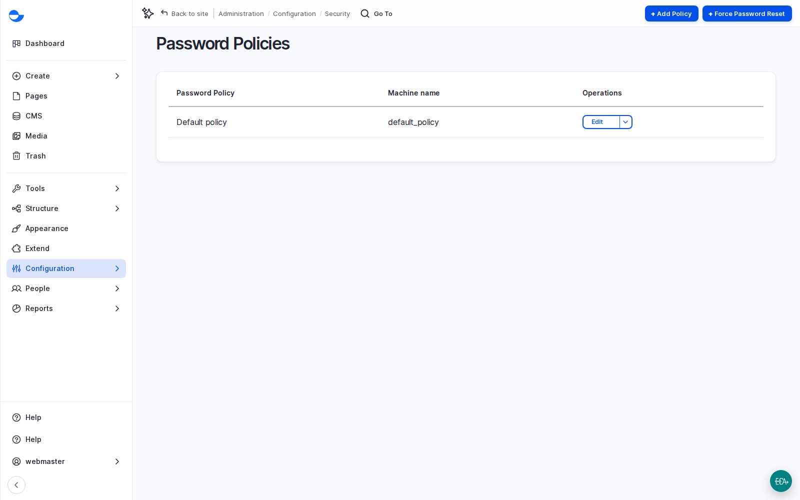
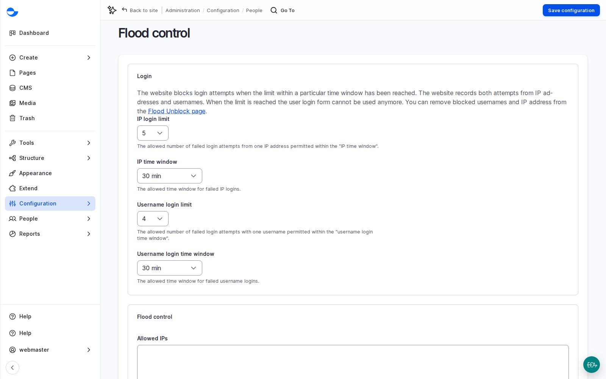
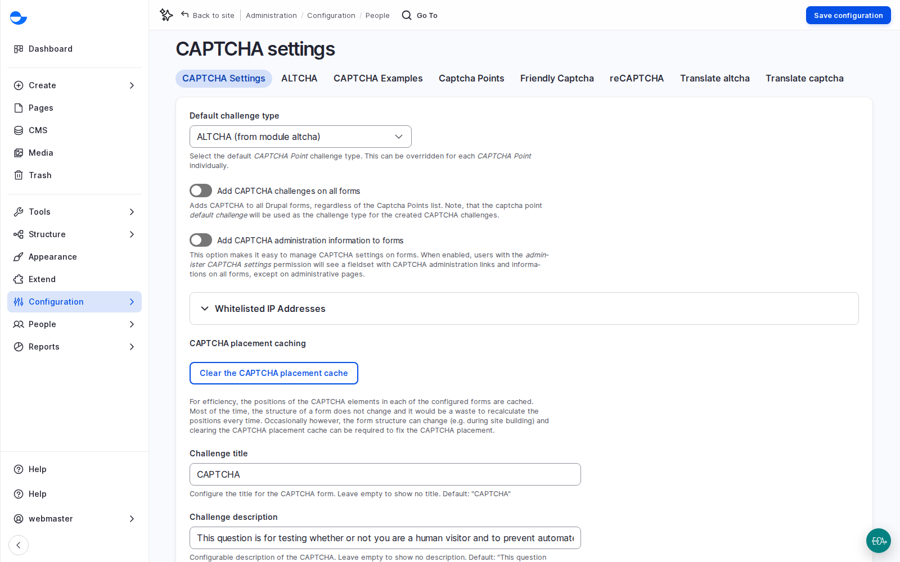
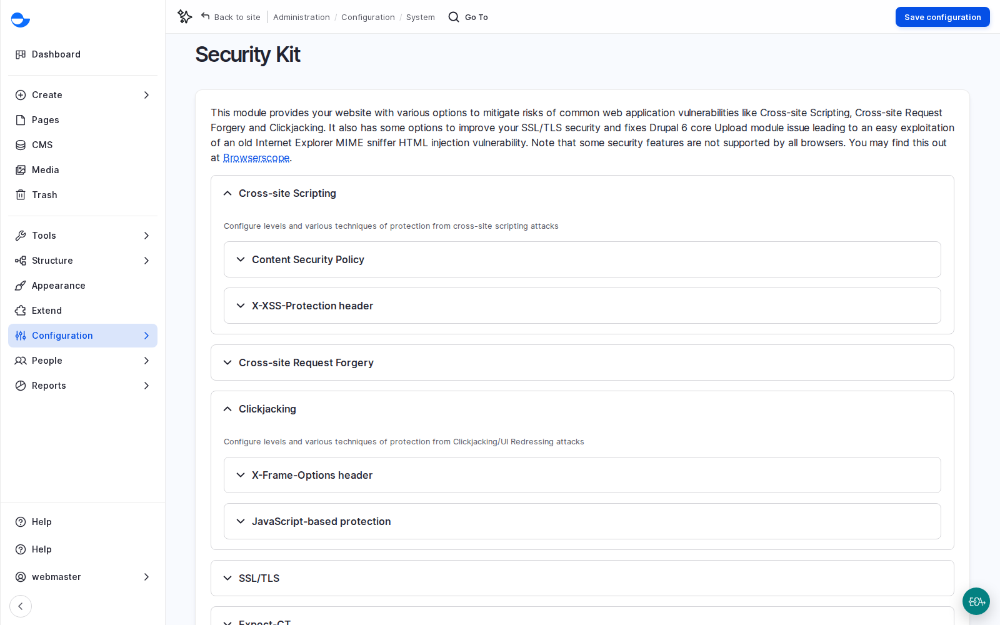
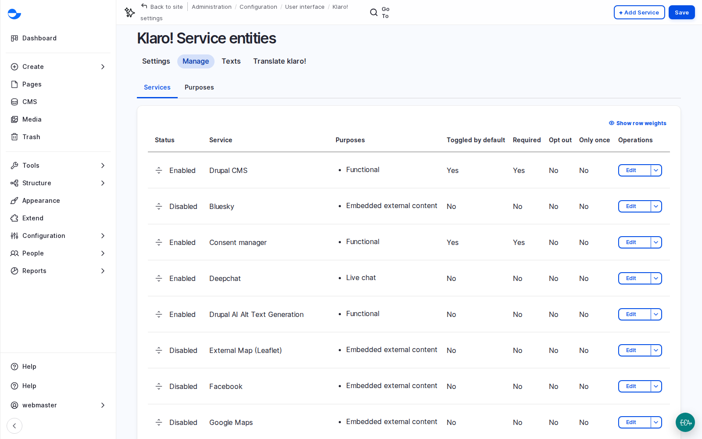

# Security and Privacy

Clients rarely ask for security in a feature list, but they always expect it, and their IT teams ask hard questions early, especially in enterprise and government projects. Varbase answers most of them with configuration that is already on. This page walks through the layers, what is switched on by default, and what a project still has to decide.

<!-- TODO(lesson-15-video): when the unlisted upload exists, replace the hint block below with an embed block for its https://youtu.be/ link, captioned "Lesson 15: Security and Privacy (Video)". -->

**Lesson 15 video: coming soon.** It will appear here and in the [Varbase: Content Designers playlist](https://www.youtube.com/playlist?list=PLRf-g9-Bc-LI).


## What It Is

Security works in layers, so one weakness does not open everything:

| Layer | What Varbase does |
| --- | --- |
| **Platform** | Drupal's security team and release schedule; Varbase follows it. Apply security updates promptly. |
| **Accounts** | A **password policy** (on a new site: at least eight characters, upper and lower case, a number and a special character, not containing the username); **flood control** (five failed logins from one address, or four for one username, within thirty minutes, block further attempts); the password reset form gives the same answer whether or not an account exists. |
| **Forms** | Quiet anti-spam checks: **Honeypot** (a hidden field robots fill in) and **Antibot** (a real browser must send the form); a visible **CAPTCHA** challenge (**ALTCHA** by default, with reCAPTCHA and Friendly Captcha available) added only where spam gets through. |
| **Browser** | **Security Kit** sends security headers, for example to stop the site being shown inside another site's frame (clickjacking). |
| **Data** | Secrets such as AI provider keys stored as keys, never shown; an audit trail of who did what; **Trash** and revisions; unpublished content answers page not found. |
| **Privacy** | A consent manager (**Klaro**) that asks visitors before loading outside services. See [Cookie Consent](cookie-consent.md). |

<figure><figcaption>
Password Policies
</figcaption></figure>

<figure><figcaption>
Flood Control Limits
</figcaption></figure>

## Why It Matters

- Fewer findings in penetration tests and security questionnaires.
- Privacy compliance support (GDPR-style consent) without custom work.
- Evidence, not promises: screenshots of these screens answer many security questions directly.

## Scenario: Unblock Someone Who Locked Themselves Out

1. A **Site Admin** goes to **People** \ _**Flood Unblock**_.
2. Find the blocked address or username and unblock it.
3. If many blocks appear for one account, treat it as a possible attack, not a forgetful user, and tell the development team.

## Scenario: Spam Gets Through a Form

1. Check which form is affected and how much spam arrives.
2. Check that form's own settings, such as limits on submissions per visitor (see [Webforms](../search-forms-and-email/webforms/)).
3. Add a visible challenge to that form only, so other forms stay friction-free. **ALTCHA** works in the background without images and without sending data to a third party.
4. Review the decision after a few weeks.

<figure><figcaption>
CAPTCHA Settings
</figcaption></figure>

<figure><figcaption>
Security Kit
</figcaption></figure>

## Privacy and Consent

Many countries require consent before a site loads services that collect personal data, such as analytics, embedded videos or chat tools. The consent manager lists each outside service with its purpose and whether it is on. On a site with the AI recipes it covers the AI chatbot and the AI alt text feature, which sends images to an AI provider; services for YouTube, Vimeo and analytics exist but stay off until the site uses them.

<figure><figcaption>
Consent Services: Which Outside Services Need the Visitor's Consent
</figcaption></figure>

- **The privacy policy** is the client's legal team's job; publishing it is a launch task. Until it is published, its footer link is hidden from visitors.
- **AI and personal data**: guardrails detect email addresses, card numbers, bank account numbers and phone numbers in what is sent to AI. See [AI Recipe Guardrails PII](../../developers/understanding-varbase/varbase-ai-recipes/ai-recipe-guardrails-pii.md).
- **Forms** store every submission until someone deletes it. Agree how long submissions are kept and who may see them.
- **Uploaded files are public** to anyone with the link. Agree another approach for sensitive documents.

## Questions Clients Ask

- **Is Varbase covered by Drupal security advisories?** Drupal core and stable contributed modules are. Recipes marked alpha (several AI recipes) are not covered by the advisory policy yet.
- **Do you support two-factor authentication or company sign-in?** Through additional modules and setup; neither is on by default. Scope it with the client's IT team.
- **What do security teams usually ask?** Hosting and server access, how fast updates are applied, how admin accounts are protected, where personal data is stored and which outside services receive it, backups, and incident response. Keep a short security summary per project.

## Planning Notes

- Hosting, WAF, backups (how often, where, how long, when a restore was last tested), secure connections and monitoring sit outside Varbase. List them in the proposal and ask the host in writing.
- Plan an independent security test two to three weeks before launch, with time to fix findings.
- Agree an incident plan: who the client calls, who responds, and the first steps (contain, assess, fix, tell).
- Agree password expiry and forced resets with the client's security team; many now prefer long passwords without expiry.
- Report security issues privately through the Drupal security process, never in a public queue.
- Habits beat settings: apply updates promptly, review accounts quarterly, never share accounts, keep secrets out of email and tickets.


**Check Yourself**

1. What happens after five failed logins from the same address?
2. Why can a footer link to the privacy policy be hidden from visitors, and who should fix it?
3. Which outside services need the visitor's consent before they load?

