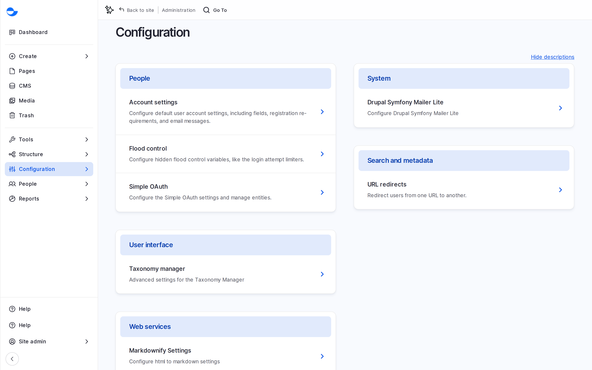

# Site Configuration

Site configuration covers the settings that apply to the whole site: its name, caching, the administration tools and the connections other systems use. Most of these settings are for a **Super Admin**; editors mostly use the tools they provide. This section explains what each area does and who uses it.

## Opening Configuration

Go to **Configuration** in the **Administration** menu (`/admin/config`). You see only the areas your role can use.

<!-- <figure><figcaption>
The Configuration Page
</figcaption></figure> -->

## Areas Editors Use

| Area | What editors do there | See |
| --- | --- | --- |
| **Search and metadata** | URL aliases, redirects, meta tags and the sitemap | [URL Management](../url-management/), [SEO Management](../search-engine-optimization/) |
| **Content authoring** | Scheduler and accessibility settings (Super Admin) | [Scheduling Content](../content-workflow/scheduling-content.md) |
| **Region and language** | Languages (Super Admin) | [Content Translation](../content-translation/) |

## In This Section

- [System](system/): site information, caching and analytics.
- [User Interface](user-interface/): **Coffee**, the **Navigation** sidebar and screen-size previews.
- [Web Services](web-services/): the connections other applications use to read your content.

## Who Changes Settings

Site-wide settings, such as the site name, performance and the administration tools, need the **Super Admin** role. A **Content Admin** or **Site Admin** can clear the cache and run scheduled tasks from **Tools** in the **Navigation** sidebar.
