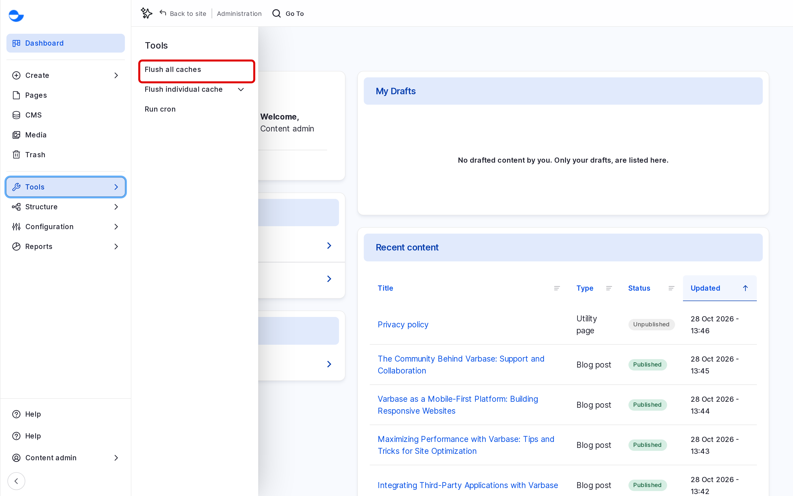

# Clearing Cache

Varbase keeps ready-made copies of pages, menus and settings, called the cache, so pages load quickly. Normally your changes show straight away. If one does not, clearing the cache makes the site build fresh copies. This page shows how.

## When to Clear the Cache

- A change you saved does not show on the site, even after reloading the page.
- A menu or a setting change is not showing.
- Your development team asks you to.

Try reloading the page first, and check you are looking at the right environment.

## Clearing All Caches

1. In the **Navigation** sidebar, open **Administration** \ **Tools**.
2. Click **Flush all caches**.

<!-- <figure><figcaption>
Flushing the Caches From Tools
</figcaption></figure> -->

Varbase shows a message when it is done. The next few pages may load a little slower while the cache is rebuilt.

## Clearing One Kind of Cache

**Tools** \ **Flush individual cache** lists separate caches, such as **Flush CSS and JavaScript** or **Flush render cache**. Use one of these when your development team names it; it is lighter than flushing everything on a busy site.

## Who Can Clear the Cache

The **Content Admin**, **Site Admin** and **Super Admin** roles. A **Super Admin** can also use **Clear all caches** on **Configuration** \ **Development** \ _**Performance**_ (`/admin/config/development/performance`).

## Tips

- Clearing the cache on a busy live site makes it slower for a short time. Do it when it is needed, not as a habit.
- If a change still does not show after clearing the cache, tell your development team which page and what you changed.
