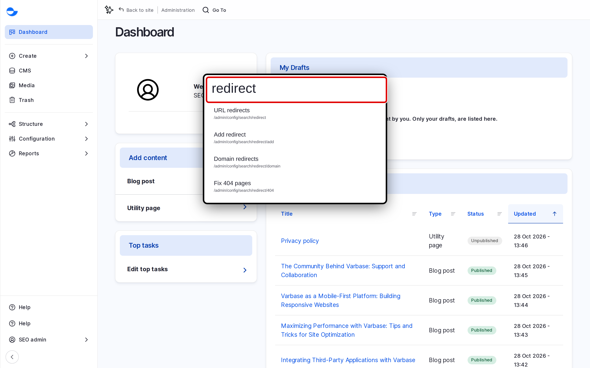

# Coffee

**Coffee** is a quick search for administration pages: you type part of a page name and jump straight to it, without browsing the menus. This page shows how to use it.

## Using Coffee

1. Press **Alt + D** (on a Mac, **Option + D**), or click **Go To** in the bar at the top of the page.
2. Type part of the page name, for example `redirect`.
3. Use the arrow keys to choose a result and press **Enter**, or click it.

<figure><figcaption>
Finding a Page With Coffee
</figcaption></figure>

Press **Esc** to close it. Hold **Ctrl** (on a Mac, **Cmd**) while choosing a result to open it in a new tab.

## What Coffee Finds

Coffee searches the pages of the **Administration** menu that your role can open, and shows up to seven results. It does not search content by title; use **CMS** for that. See [Content Management](../../content-management/).

## Examples

| Type | To open |
| --- | --- |
| `menus` | **Menus** |
| `taxonomy` | **Taxonomy** |
| `redirect` | **URL redirects** |
| `trash` | **Trash** |

## Who Can Use It

The **Content editor**, **Content Admin**, **SEO Admin** and **Site Admin** roles.
