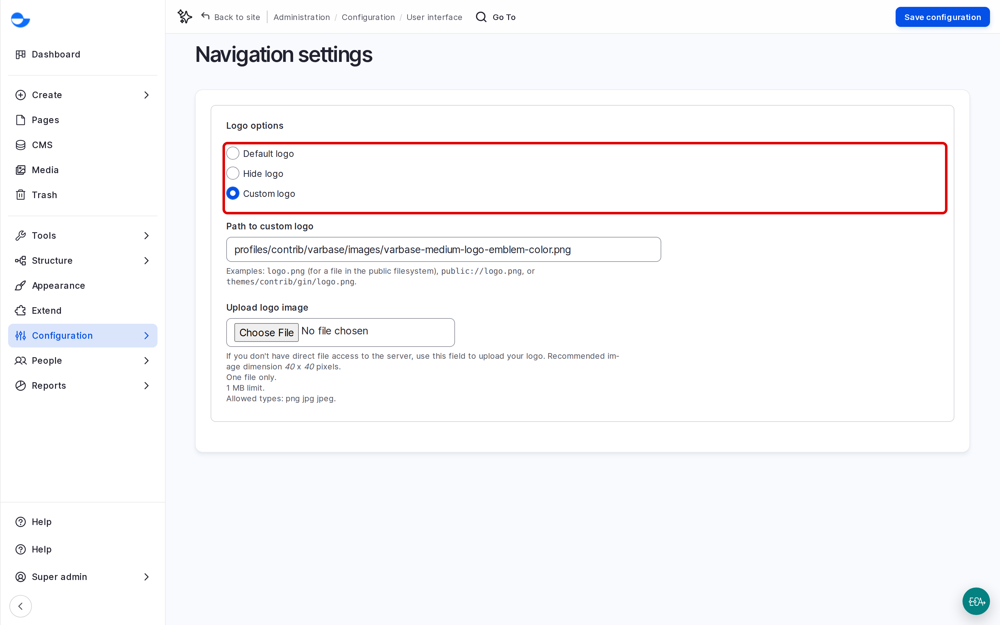

# Navigation Settings

The **Navigation** sidebar is the menu on the left of every administration page. Its contents follow each person's role, so there is little to configure. This page covers the one setting there is, and points to how to use the sidebar.

## Using the Sidebar

See [Navigation Sidebar](../../accessing-the-administration-area/navigation-sidebar.md) for the parts of the sidebar, collapsing it and the **Tools** menu.

## Changing the Sidebar Logo

A **Super Admin** can change the logo at the top of the sidebar:

1. Go to **Configuration** \ **User interface** \ _**Navigation**_ (`/admin/config/user-interface/navigation/settings`).
2. Under **Logo options**, in **Choose logo handling**, choose **Custom logo** and upload the image. Keep it small and square; it is shown at up to 40 by 40 pixels.
3. Click **Save configuration**.

<figure><figcaption>
The Navigation Settings
</figcaption></figure>

## Tips

- Use a logo that differs between environments, for example a staging version, so editors always know which site they are on.
