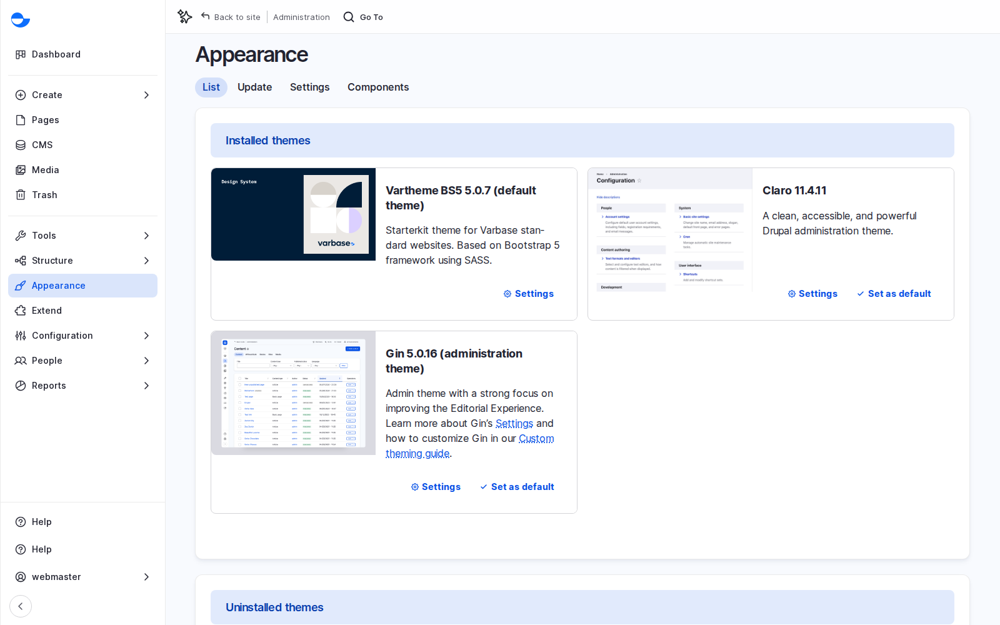
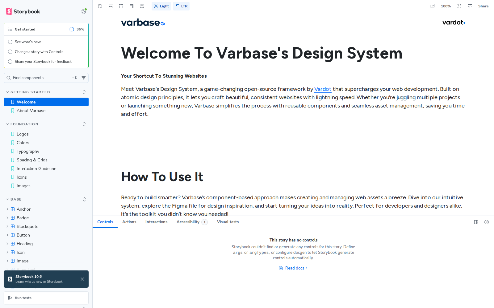

# The Design System

A design system is a shared set of building blocks and rules for how a site looks and behaves: colours, fonts, spacing, and components such as buttons, cards and forms. On a Varbase Starter site it lives in the **Vartheme BS5** theme, and it is what keeps Drupal Canvas pages on brand. This page explains how it works, how a client's brand is applied, and how to use **Storybook** in a project.


Lesson 10: The Design System (Video)


## What It Is

- **Vartheme BS5** is the default front-end theme, built on **Bootstrap 5**, an open-source framework with a proven grid, responsive behaviour and accessible patterns. Vartheme adds Varbase's own components. The admin area uses the **Gin** theme.
- **Components** are organised from small to large: the **foundation** (colours, typography, spacing and grids, icons, images, logos), **atoms** (button, heading, image, badge, form field), **molecules** (accordion, breadcrumb, share bar, tabs) and **organisms** (cards, heroes, header). About 130 components; 46 appear in the Drupal Canvas library. See the [Component Catalog](../building-pages-with-drupal-canvas/component-catalog/).
- **Variants** are the named choices a component allows, such as a primary or secondary button and its sizes. Editors pick a variant; they do not type colours or fonts.
- **Tokens** are named values such as the primary colour, the heading font or the standard spacing. Change a token and every component follows.
- **Starter kit**: a project creates its own theme from Vartheme BS5 for the client's brand, rather than editing Vartheme. The site templates do this: Educare, Horizon Aid and The Rightup each have their own theme on Vartheme BS5.

<figure><figcaption>
Vartheme BS5 Is the Default Theme and Gin the Admin Theme
</figcaption></figure>

Each component declares its settings, and Drupal Canvas turns them into the form in the right panel. When a developer adds a component or a variant to the theme, editors see it in Canvas with no extra work.

## Why It Matters

- **Consistency**: many editors build pages, and the brand stays intact.
- **Speed**: new pages are assembled from existing parts; forms look right without design work.
- **Cost over time**: a fix to one component reaches every page that uses it, including accessibility and responsiveness, solved once per component.
- **Lean pages**: styles are built once and cached, so pages stay fast on phones.

## Storybook

**Storybook** shows every component on its own, outside any page, with **stories** for its variants and states. It is for the project team (designers, developers, testers, product owners), not for visitors, and it runs on development and staging sites, not production.

<figure><figcaption>
Storybook: Foundations and Every Component
</figcaption></figure>

### Scenario: Review a Component in Storybook

1. Open your project's Storybook (ask your development team for the address), or the public demo at `storybook.demo.varbase.vardot.com`.
2. Start with **Getting Started** and **Foundation**: colours, typography and the spacing scale.
3. Search for a component, such as **Button** or **Card**, and open its stories to see every variant side by side.
4. In **Controls**, change its settings: type a longer title, switch a variant, remove the image. Check how it copes with awkward content, long words and right-to-left text.
5. Check it with the keyboard, read its text alternatives, and look at contrast. Problems found here are fixed once, for every page.
6. Open the Drupal Canvas **Library** and find the same component there.

## Scenario: Map a Design to the System

Take the client's designs page by page and label every element:

| Label | Cost |
| --- | --- |
| An existing component, as it is | Almost nothing |
| An existing component with a new variant | A little |
| A new component | The most: design, build, accessibility, testing and upkeep |

**Worked example.** A design has a hero, three feature cards, a timeline of the organisation's history and an interactive map of offices. The hero and cards exist, perhaps with one new card variant. The timeline is a new component unless the client accepts an accordion or a list of cards. The map is a new component with outside services involved. The labels turn the design into a clear estimate and a conversation about trade-offs.

## Applying a Brand

- **Settings**: the logo, the browser icon, the content width, a sticky header.
- **Design work** (front-end developer): colours, fonts, spacing and component shapes, set as tokens in the theme's style files.
- **Fonts**: a brand font needs a web licence and affects page speed (Varbase can preload fonts). Arabic and other scripts need fonts that support them.
- **Beyond pages**: the emails the site sends have their own theme (see [Easy Email Recipes](../../developers/understanding-varbase/easy-email-recipes/)), and the theme includes a print logo.

Questions for the brand kick-off:

1. Do you have digital brand guidelines, with colours, fonts and logo versions?
2. Are your fonts licensed for the web, and do they cover every language you need?
3. Do your colours meet accessibility contrast rules for text?
4. Which existing sites or pages do you like, and why?
5. Who approves design decisions?

## Who Changes What

- **Editors** choose components and variants in Drupal Canvas.
- **Designers** define the tokens, variants and new components.
- **Developers** build and maintain the theme and keep it in step with Varbase updates.
- **Product owners** decide what is worth adding to the system, based on how often it will be used.

## Questions Clients Ask

- **Can we use our Figma design system?** Yes: the components are themed to it. The optional Varbase AI Figma recipes can also turn Figma frames into Canvas pages (alpha). See [Varbase AI Figma](../../developers/understanding-varbase/varbase-ai-recipes/varbase-ai-figma.md).

## Planning Notes

- Run a component inventory against Vartheme BS5 early: reuse, restyle or new. New components carry the most effort.
- Design each key page for a phone as well as a desktop, using the theme's breakpoints. A desktop-only design is half a design.
- After launch, check every new request against the library first, remove unused variants, and keep Storybook up to date.
- Developers: see [Understanding Vartheme BS5](../../developers/theme-development-with-varbase/understanding-vartheme-bs5.md), [Creating Your Own Theme](../../developers/theme-development-with-varbase/creating-your-own-theme.md) and [Integration of Varbase With Storybook](../../developers/theme-development-with-varbase/integration-of-varbase-with-storybook.md).


**Check Yourself**

1. Why do editors choose variants instead of colours?
2. What is the difference in cost between using an existing component, adding a variant and creating a new component?
3. Who uses Storybook in a project, and for what?

