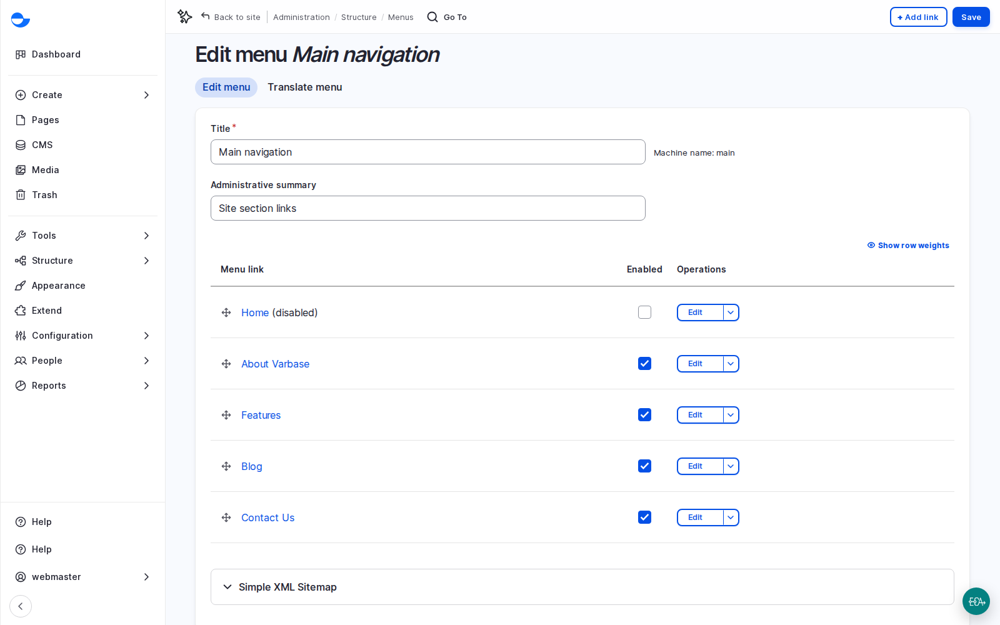
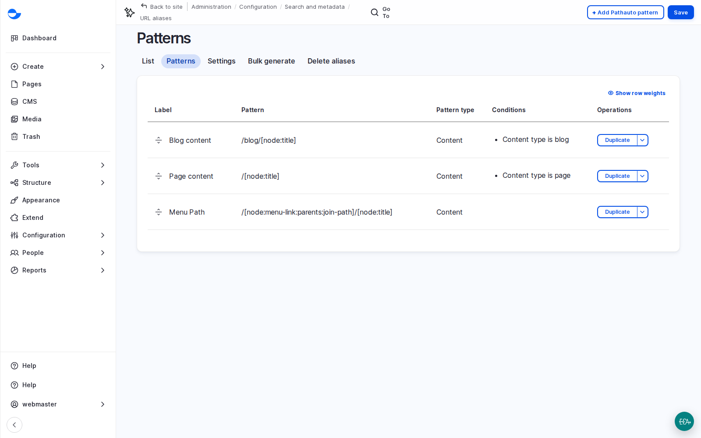

# Navigation and Web Addresses

A site can have excellent content and still fail visitors who cannot find their way. This section covers the menus that guide people, the readable addresses (URLs) that identify each page, and the redirects that keep old links working. Varbase automates most of it, which is where launches usually go wrong.

<!-- TODO(lesson-11-video): when the unlisted upload exists, replace the hint block below with an embed block for its https://youtu.be/ link, captioned "Lesson 11: Navigation and Web Addresses (Video)". -->

**Lesson 11 video: coming soon.** It will appear here and in the [Varbase: Content Designers playlist](https://www.youtube.com/playlist?list=PLRf-g9-Bc-LI).


## What It Is

- **Menus**: **Main navigation**, **Footer**, **Secondary menu** and **Social media menu** are the visitor menus, under **Structure** \ _**Menus**_. Links are reordered and nested by dragging, and can be disabled without deleting. See [Menu Management](menu-management/).
- **URL aliases**: readable addresses such as `/blog/securing-your-site`, generated from patterns. Blog posts get `/blog/[title]`, utility pages `/[title]`. **Drupal Canvas pages and taxonomy terms get no automatic alias**: set their address by hand. See [URL Aliases](url-aliases.md).
- **Redirects**: send anyone who asks for one address to another. When a title changes, Varbase adds a redirect from the old address for you. See [URL Redirects](url-redirects.md).
- **Fix 404 pages**: a report of addresses visitors asked for and did not find, each with **Add redirect**.
- **Breadcrumbs** and the **active trail**: the path to the current page, and the highlighted menu item for the current section, built from the page's address and place in the menu.

<figure><figcaption>
Editing the Main Navigation Menu
</figcaption></figure>

<figure><figcaption>
URL Alias Patterns per Content Type
</figcaption></figure>

## Why It Matters

- Search rankings survive a relaunch when old addresses redirect to new ones.
- Editors fix broken links themselves from the 404 report, without a developer.
- Readable addresses look trustworthy when shared and make good breadcrumbs.

## Scenario: Fix a Broken Footer Link

On the course's demo site, the **Fix 404 pages** report showed `/terms-and-conditions` at the top: the footer linked to a page that did not exist.

1. Go to **Configuration** \ **Search and metadata** \ **URL redirects** \ _**Fix 404 pages**_ (`/admin/config/search/redirect/404`). Sort by **Count**.
2. Confirm the problem as a visitor: follow the link and see the page not found.
3. Choose the fix:
   - **Long term**: create the missing page. The link starts working by itself.
   - **Quick**: click **Add redirect** next to the address, set **To** to an existing page (start typing its title), keep **301 Moved Permanently**, and **Save**.
4. Follow the link again to check it.

Not every entry needs a redirect: some are robots probing the site. Fix the ones with high counts.

## Scenario: Give a Campaign a Short Address

1. Go to **URL redirects** and click **Add redirect**.
2. Enter a short **Path**, such as `/open-day`, and set **To** to the real page.
3. Use the short address on posters and radio spots. When the campaign ends, point the redirect somewhere else, and the poster still works.

## Scenario: Plan Redirects for a New Site

1. Export the old site's addresses, especially the most visited ones and those linked from other sites. The client's analytics hold this.
2. Map each one to its new address.
3. Import the list before launch, then test the top addresses on launch day.
4. Watch **Fix 404 pages** weekly in the first months, then monthly.

## Good Habits

- **Link to the page, not its address.** In menus and the editor, start typing the page's title and pick it. The link keeps working if the address changes.
- **Disable, do not delete** a menu link that should disappear for a while. Deleting a link never deletes its page.
- **Menu links hide themselves** for visitors when their page is unpublished. Before launch, check that every menu link leads to a published page.
- **Avoid redirect chains and loops**: an address that redirects to another redirect, or two that redirect to each other. Review the redirect list once a year.
- **Custom addresses are the exception**: they do not update when the title changes.

## Questions Clients Ask

- **Can addresses be in Arabic letters?** Each translation has its own address with the language prefix (`/ar`). By default, Arabic titles become Latin letters, which are safe to share and type; addresses in the original script are a setting to agree per language.
- **Can the old domain or the address without www send visitors to the main domain?** Yes, with domain redirects. It involves the client's IT team and domain registrar; start early.

## Planning Notes

- Agree the menu tree before pages are built: main menu (five to seven items), footer groups, social and legal links, and who may change each menu after launch. Varbase can grant permission menu by menu.
- Agree address rules: the pattern per content type, how languages appear, how non-Latin titles are written, and when custom addresses are allowed.
- List every Drupal Canvas page with its agreed address, since none is generated. Do the same for term pages if they are public.
- For a relaunch, the redirect map is a deliverable with an owner and a deadline. Assumption: importing a prepared map takes hours; building it is the real work.
- Name an owner for the 404 report, often the **SEO Admin**.

## Launch Checklist

1. Every menu link leads to a published page.
2. **Fix 404 pages** is cleared of real problems.
3. The redirect list from the old site is imported and tested.
4. Breadcrumbs and the active trail behave correctly for each content type.
5. The main menu works with a keyboard and on a phone.

## Who Can Manage Addresses

The **Content editor**, **Content Admin**, **SEO Admin** and **Site Admin** roles can set addresses on content and manage redirects. The **Content editor** and **SEO Admin** roles can also manage the list of all URL aliases.

## In This Section

- [Menu Management](menu-management/)
- [URL Aliases](url-aliases.md)
- [URL Redirects](url-redirects.md)


**Check Yourself**

1. Why should a menu link point to the page itself rather than to its address?
2. What happens to an old address when a post's title changes?
3. What would you do first with a new client's old website addresses?

