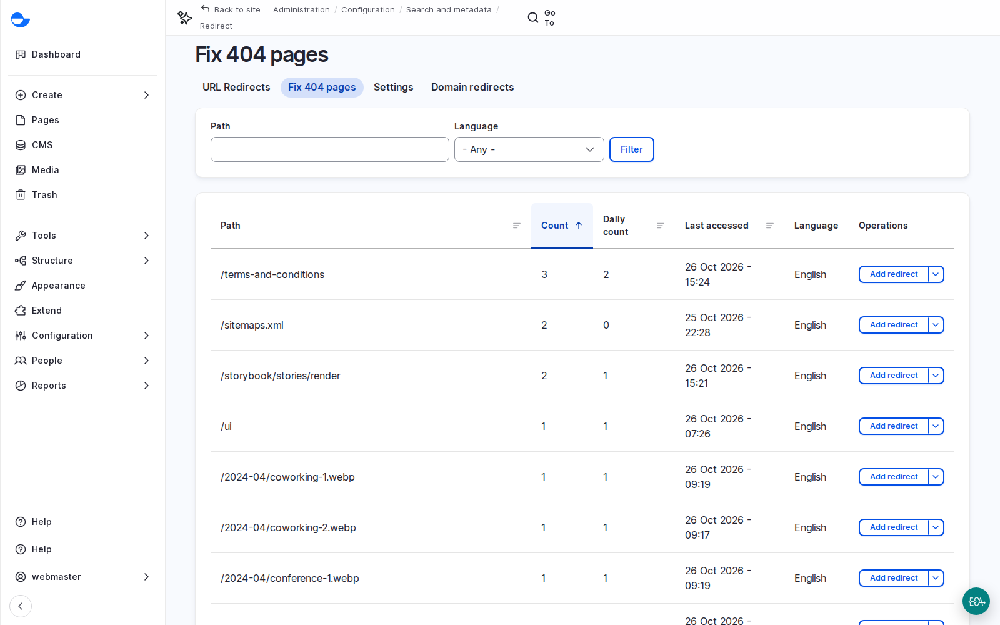

# Fix a Broken Link

The **Fix 404 pages** report lists the addresses visitors asked for and did not find, with how often. Working down it is the quickest way to find a broken link on your own site. On a demo site it showed `/terms-and-conditions` at the top: the footer linked to a page that did not exist.

## Steps

1. Go to **Configuration** \ **Search and metadata** \ **URL redirects** \ _**Fix 404 pages**_ (`/admin/config/search/redirect/404`). Sort by **Count**.
2. Confirm the problem as a visitor: follow the link and see the page not found.
3. Choose the fix:
   - **Long term**: create the missing page. The link starts working by itself.
   - **Quick**: click **Add redirect** next to the address. On **Add URL redirect**, **Path** is already filled in. Set **To** to an existing page (start typing its title), keep **301 Moved Permanently** in **Redirect status**, and **Save**.
   - In a real project, log both: the redirect now, and the missing page as a task.
4. Follow the link again to check it.

<figure><figcaption>
The Fix 404 Pages Report
</figcaption></figure>

Not every entry needs a redirect: some are robots probing the site, or guesses such as `/sitemaps.xml`. Fix the ones with high counts.


On a new Varbase Starter site, the **Terms and Conditions** link in the footer leads to `/terms-and-conditions`, which is a page not found: the demo content adds the menu link but no page. Before launch, create the page, or redirect the address, or disable the link in the **Footer** menu.


## Planning Notes

- Name an owner for the report, often the **SEO Admin**.
- Check it weekly in the first months after launch, then monthly.
