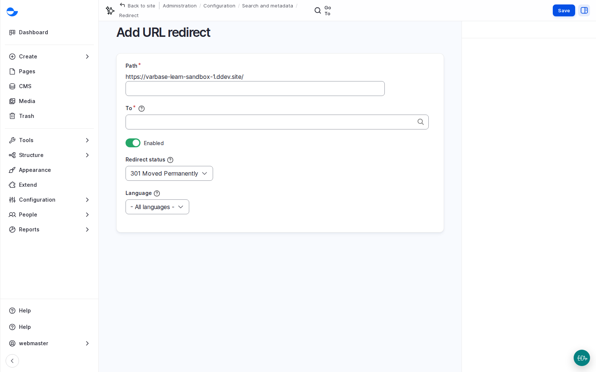

# Give a Campaign a Short Address

A short address such as `/open-day` is easy to print on a poster or say on the radio. A redirect sends it to the real page, and you can point it somewhere else later without reprinting anything.

## Steps

1. Go to **Configuration** \ **Search and metadata** \ _**URL redirects**_ and click **Add redirect**.
2. Enter a short **Path**, such as `/open-day`.
3. Set **To** to the real page: start typing its title and pick it.
4. Keep the redirect status and click **Save**.
5. Visit the short address to check it.

<figure><figcaption>
Adding a Redirect
</figcaption></figure>

When the campaign ends, edit the redirect and point it at another page, and the poster still works.

## Tips

- Keep short addresses short, lower case and free of dates, so they can be reused.
- Avoid a short address that is also a real page's address.
