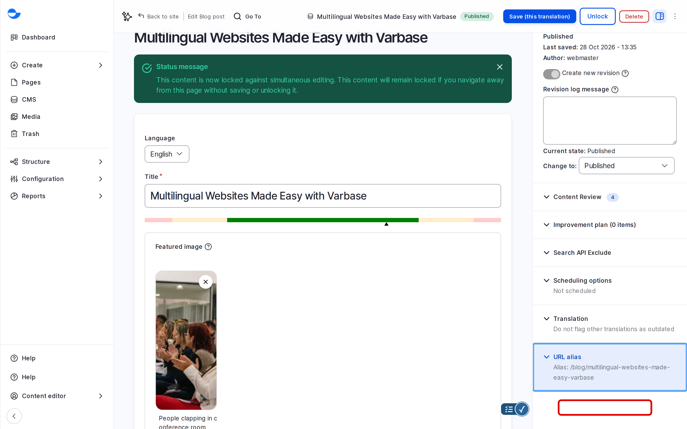
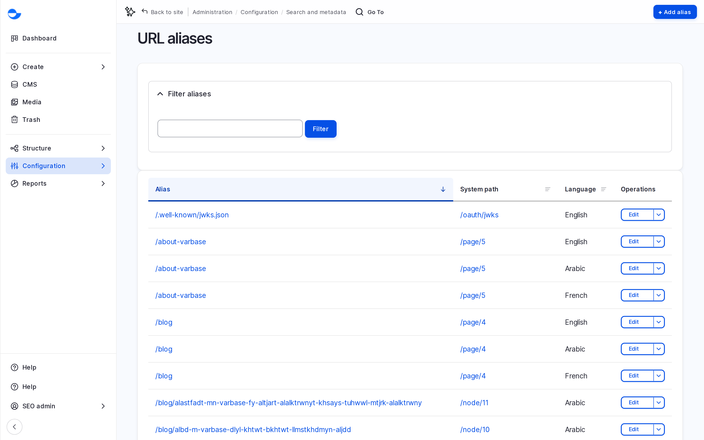

# URL Aliases

A URL alias is the readable address of a page, such as `/about-varbase` instead of the system address `/page/5`. This page explains how Varbase creates aliases and how to set your own.

## Automatic Aliases

Varbase creates the alias from the title when you save:

| Content | Alias pattern | Example |
| --- | --- | --- |
| **Blog post** | `/blog/` and the title | `/blog/multilingual-websites-made-easy-with-varbase` |
| **Utility page** | The title | `/privacy-policy` |

If you change the title, the alias changes too, and the old address redirects to the new one.

<figure><figcaption>
The URL Alias of a Blog Post
</figcaption></figure>

## Setting Your Own Alias

1. Edit the item and open **URL alias** in the sidebar.
2. Untick **Generate automatic URL alias**.
3. Type the alias, starting with `/`, for example `/offers/spring-sale`.
4. Save.

## Drupal Canvas Pages and Terms

Drupal Canvas pages and taxonomy terms do not get an automatic alias. Set it yourself:

- For a page, in **URL alias** in the **Page data** panel of the editor. See [Building Pages With Drupal Canvas](../building-pages-with-drupal-canvas/).
- For a term, in **URL alias** on the term form.

Without an alias, the page uses its system address, such as `/page/7`.

## The List of All Aliases

Go to **Configuration** \ **Search and metadata** \ _**URL aliases**_ (`/admin/config/search/path`) to see every alias with its **System path**. Filter by alias, and click **Edit** to change one.

<figure><figcaption>
The URL Aliases List
</figcaption></figure>

## Tips

- Use short, lowercase words separated by hyphens.
- Avoid dates in aliases unless the content is about that date.
- On a multilingual site, each translation can have its own alias.
