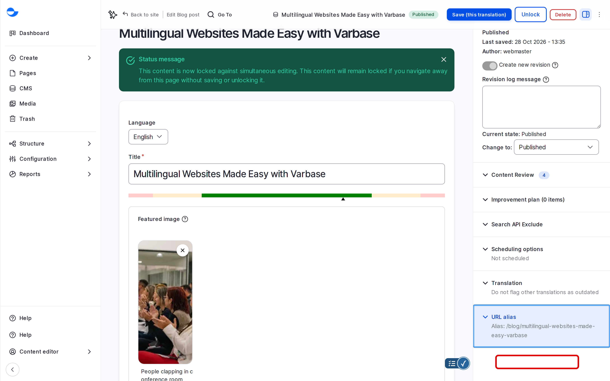
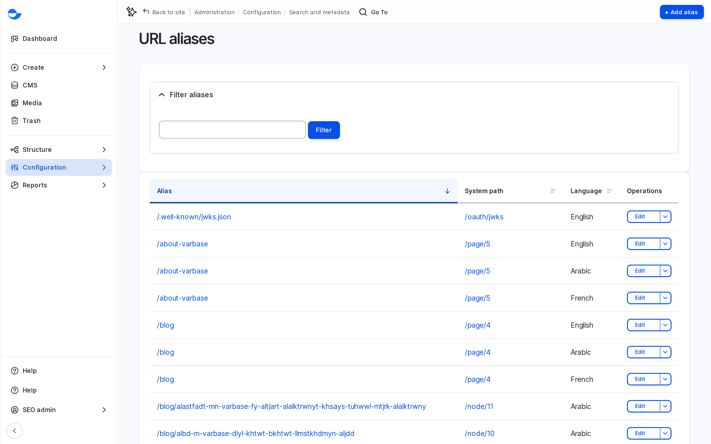

# URL Aliases

A URL alias is the readable address of a page, such as `/about-varbase` instead of the system address `/page/5`. This page explains how Varbase creates aliases and how to set your own.

## Automatic Aliases

Varbase creates the alias from the title when you save:

| Content | Alias pattern | Example |
| --- | --- | --- |
| **Blog post** | `/blog/` and the title | `/blog/multilingual-websites-made-easy-with-varbase` |
| **Utility page** | The title | `/privacy-policy` |

If you change the title, the alias changes too, and the old address redirects to the new one. A custom alias you typed yourself does not follow the title, so keep custom aliases for the exceptions, such as a campaign.

<figure><figcaption>
The URL Alias of a Blog Post
</figcaption></figure>

## Setting Your Own Alias

1. Edit the item and open **URL alias** in the sidebar.
2. Untick **Generate automatic URL alias**.
3. Type the alias, starting with `/`, for example `/offers/spring-sale`.
4. Save.

## Drupal Canvas Pages and Terms

Drupal Canvas pages and taxonomy terms have no alias pattern:

- For a page, **URL alias** in the **Page data** panel of the editor fills in from the title as you type it, for example `/training-programme`. Change it there if you want another address; once you do, the title no longer changes it. See [Building Pages With Drupal Canvas](../building-pages-with-drupal-canvas/).
- For a term, set **URL alias** on the term form yourself.

Without an alias, the page uses its system address, such as `/page/7`.

## The List of All Aliases

Go to **Configuration** \ **Search and metadata** \ _**URL aliases**_ (`/admin/config/search/path`) to see every alias with its **System path**. To find one, type part of it, such as `blog`, in the **Filter aliases** group above the list and click **Filter**. Click **Edit** to change an alias.

<figure><figcaption>
The URL Aliases List
</figcaption></figure>

## Rebuilding Aliases After a Pattern Change

When an alias pattern changes, or after content is migrated, existing items keep their old aliases until the aliases are rebuilt:

- **One item or a few**: in the content list, tick the items and use the **Update URL alias** action. See [Bulk Edit Content](../content-workflow/bulk-edit-content.md).
- **Everything of a type**: a **Super Admin** uses the **Bulk generate** page of **URL aliases** (`/admin/config/search/path/update_bulk`).


In the Gin admin theme, the **URL aliases** page shows no **Bulk generate** tab. Open `/admin/config/search/path/update_bulk` directly.



Changing a pattern on a live site changes many addresses at once. Plan the redirects from the old addresses before you rebuild. See [URL Redirects](url-redirects.md).


## Tips

- Use short, lowercase words separated by hyphens.
- Avoid dates in aliases unless the content is about that date.
- On a multilingual site, each translation can have its own alias.
