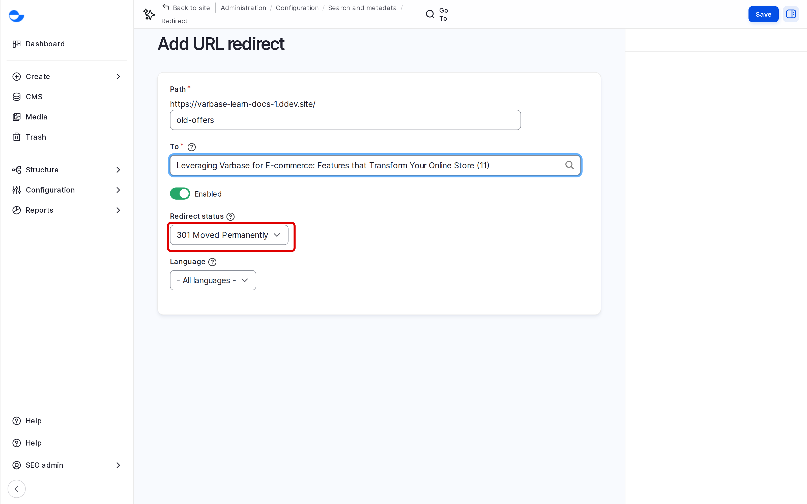
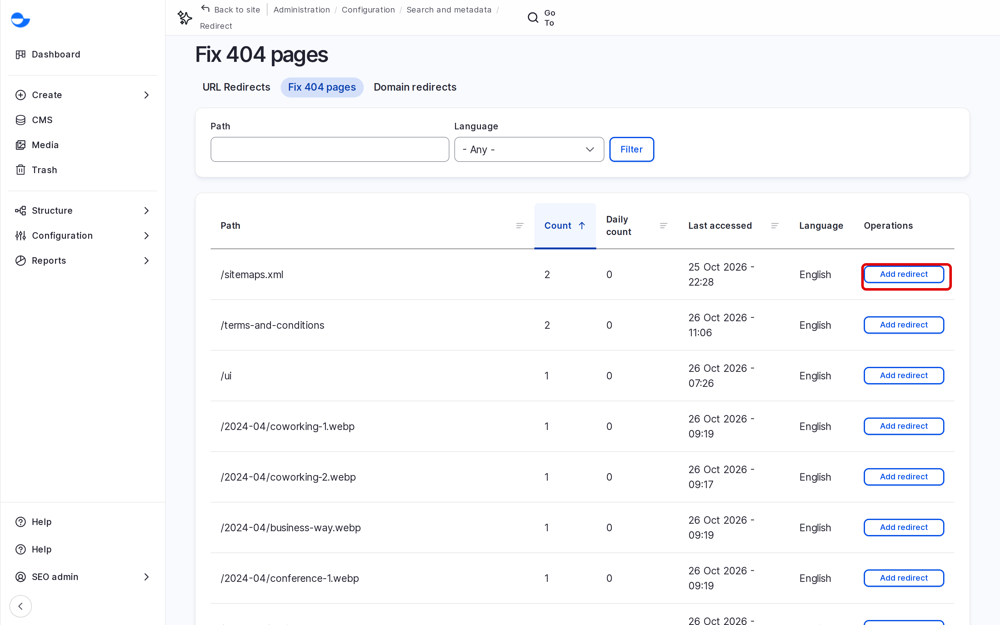

# URL Redirects

A redirect sends visitors, and search engines, from one address to another. Use one when a page moves or is replaced, so links from other sites and bookmarks keep working. This page shows how to add and manage redirects.

## Redirects Varbase Adds for You

When an automatic alias changes, for example because you renamed a blog post, Varbase adds a redirect from the old address to the new one. These redirects appear in the list like any other.

## Adding a Redirect

1. Go to **Configuration** \ **Search and metadata** \ _**URL redirects**_ (`/admin/config/search/redirect`).
2. Click **Add redirect**.
3. Fill in:
   - **Path**: the old address, without the domain, for example `old-offers`.
   - **To**: start typing the title of the new page and pick it, or enter an address.
   - **Redirect status**: keep **301 Moved Permanently** for a permanent move. Use a temporary status only for a short-term change.
4. Click **Save**.

<!-- <figure><figcaption>
Adding a Redirect
</figcaption></figure> -->

## Finding Old Links That Need a Redirect

1. On the **URL redirects** page, open **Fix 404 pages** (`/admin/config/search/redirect/404`).
2. The list shows addresses visitors asked for that do not exist, with how many times.
3. Click **Add redirect** next to an address to send it to the right page.

<!-- <figure><figcaption>
Fixing Missing Pages With Redirects
</figcaption></figure> -->

## Editing or Deleting a Redirect

In the list, click **Edit** next to the redirect, or choose **Delete** from its operations.

## Tips

- Point a redirect straight at the final page, never at another redirect.
- Test a new redirect by opening the old address in a private browser window.
- Keep redirects for moved pages; removing them breaks old links again.
