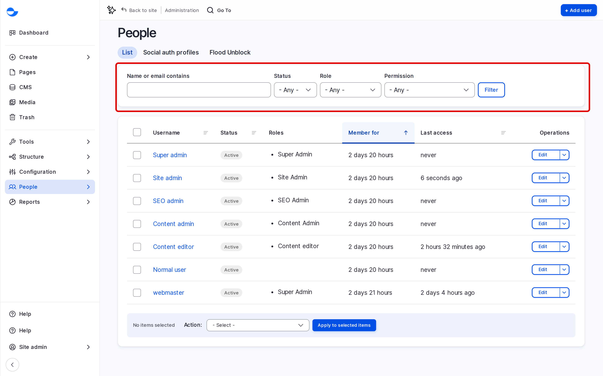

# User Management

Everyone who works on your Varbase site has their own account, and each account has one or more roles that decide what it can do. This section shows how people log in, how accounts are added, changed and removed, and what each role allows.

## The People List

Go to **People** (`/admin/people`) to see every account.

<!-- <figure><figcaption>
The People List
</figcaption></figure> -->

- Filter by **Name or email contains**, **Status**, **Role** or **Permission**, then click **Filter**.
- Click **Edit** next to an account to change it.
- Tick several accounts to block or unblock them, or to add or remove a role, with the **Action** list.

## Who Manages Accounts

A **Site Admin** can add, edit, block and cancel accounts, and switch to another role to check what it sees. Giving roles to people, and changing what a role can do, are **Super Admin** tasks unless your Super Admin has allowed a **Site Admin** to assign certain roles. See [Managing Roles](default-roles-and-site-persons/managing-roles.md).

## In This Section

- [Login and Registration](login-and-registration.md)
- [Add User](add-user.md)
- [Edit User](edit-user.md)
- [Delete User](delete-user.md)
- [Default Roles and Site Personas](default-roles-and-site-persons/)
  - [Managing Roles](default-roles-and-site-persons/managing-roles.md)
