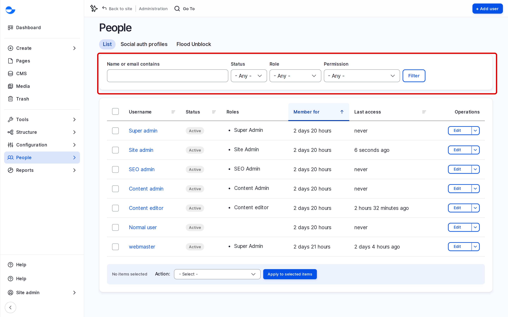
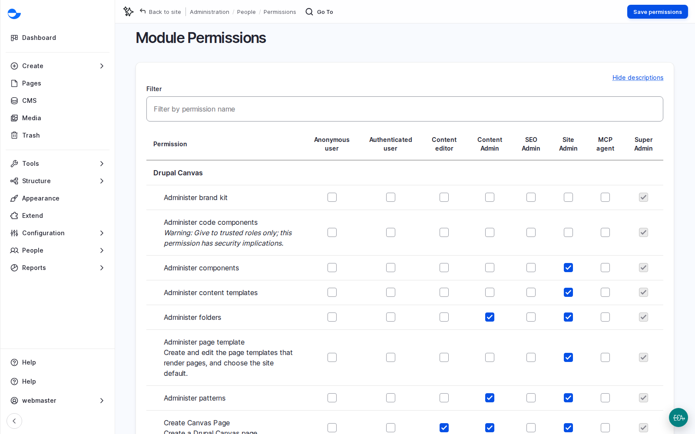

# Users, Roles, Personas and Permissions

Everyone who works on your Varbase site has their own account, and each account has one or more roles that decide what it can do. Varbase ships roles that match real editorial jobs, so the permission plan starts mostly done. This section shows how people log in, how accounts are added, changed and removed, what each role allows, and how to plan access with a client.

<!-- TODO(lesson-14-video): when the unlisted upload exists, replace the hint block below with an embed block for its https://youtu.be/ link, captioned "Lesson 14: Users, Roles, Personas and Permissions (Video)". -->

**Lesson 14 video: coming soon.** It will appear here and in the [Varbase: Content Designers playlist](https://www.youtube.com/playlist?list=PLRf-g9-Bc-LI).


## What It Is

- An **account** belongs to one person and holds personal data: name, email, picture, language, time zone.
- A **role** is a named set of permissions. Change a role and everyone with it changes at once. A person can hold more than one role and gets the combined permissions.
- **Personas** are the typical jobs the default roles are designed around:

| Role | Persona | Typical rights |
| --- | --- | --- |
| **Content editor** | Writer | Create, edit and publish blog posts and utility pages; create and edit Drupal Canvas pages but not publish them; upload media |
| **Content Admin** | Editorial lead | Everything an editor does, plus publish Canvas pages; menus, terms, webforms, Canvas patterns, entity queues |
| **SEO Admin** | SEO specialist | Meta tags, aliases, redirects, sitemap, llms.txt; edits and publishes posts and utility pages; no Canvas pages |
| **Site Admin** | Site manager | Accounts, most settings, webforms, page and content templates, publish Canvas pages; assigns roles once the Role assign list is set up; cannot change permissions |
| **MCP agent** | An outside AI assistant | Draft posts and pages only, never publish (see [Varbase AI MCP Server Base](../../developers/understanding-varbase/varbase-ai-recipes/varbase-ai-mcp-server-base.md)) |
| **Super Admin** | Technical administrator | Everything, including permissions, the Status report, available updates and the accessibility report. Keep to very few people |

A logged-out visitor has the **Anonymous user** role, and every account starts as **Authenticated user** (a "normal user" with no admin sidebar) before a role is added. See [What Each Role Sees](default-roles-and-site-persons/what-each-role-sees.md).

## Why It Matters

- Least privilege by default supports audits and security reviews.
- Clear personas make training and onboarding faster: train by role, with the role's own test account.
- One person, one account means you always know who did what.

## The People List

Go to **People** (`/admin/people`) to see every account.

<figure><figcaption>
The People List
</figcaption></figure>

- Filter by **Name or email contains**, **Status**, **Role** or **Permission**, then click **Filter**.
- Click **Edit** next to an account to change it.
- Tick several accounts to block or unblock them, or to add or remove a role, with the **Action** list.

## Who Manages Accounts

A **Site Admin** can add, edit, block and cancel accounts, and switch to another role to check what it sees. Giving roles to people, and changing what a role can do, are **Super Admin** tasks unless your Super Admin has allowed a **Site Admin** to assign certain roles. See [Managing Roles](default-roles-and-site-persons/managing-roles.md).

## Scenario: Onboard and Offboard People

1. **Add**: on **People**, click **Add user**, enter the email and username, choose the status and roles, and tick the option to email password set-up instructions. Nobody else ever knows their password. See [Add User](add-user.md).
2. **Partners and freelancers**: their own account, the narrowest role that fits, and a noted end date.
3. **Leave**: on the day someone leaves, block or cancel the account. Cancelling disables it and keeps its content, so the history of who wrote what stays. See [Delete User](delete-user.md).
4. **Review quarterly**: sort **People** by last access and ask the client whether each person still needs access.

## Reading Permissions

**People** \ _**Permissions**_ shows every permission as a row and every role as a column. Type a word such as `publish` in the filter. Each role's own page shows only its column, which is easier to read with a client.

<figure><figcaption>
Drupal Canvas Permissions per Role
</figcaption></figure>

- **Workflow transitions are permissions**: send to review, publish, archive. Changing who may publish is a few ticks that change how the whole team works.
- **Finer permissions**: a role can manage one menu but not another, or one vocabulary but not others.
- **Custom permissions**: an administrator can create a permission for one admin page without a developer.
- **Restricted permissions** carry a warning; never give them to editorial roles.
- **After every feature update**, check whether editorial roles need the new permissions, which often arrive given to nobody.

## Scenario: Check a Role With Masquerade

A **Site Admin** can temporarily act as an editorial account to see the site as that role.

1. On **People**, open the account's operations and choose **Masquerade as**.
2. Do the role's main tasks from start to finish, then try something it should not do and confirm it is refused.
3. Switch back by logging out of the masqueraded session, then log in again.


On a Varbase 11.0 site the Gin navigation does not show an **Unmasquerade** link. Log out to end a masquerade session.


## Scenario: Build a Role Matrix With a Client

1. List the people or groups who will use the site, their tasks, the content they own and their languages.
2. Map each group to the closest default role. Most fit exactly.
3. Draw a matrix: roles down the side, main tasks across the top, a tick where a role may do the task. It is easier to approve than a list of permissions and becomes the basis for testing.
4. Set up **Role assign** (**People** \ _**Role assign**_) before handover, so the client's **Site Admin** can give roles. Keep **Super Admin** out of the list.
5. Agree how access requests work after launch: who asks, who approves, who grants, and when access ends.

## Questions Clients Ask

- **Can people edit only their own section?** Roles give access by type of content, not by section. Section-level access is possible with extra configuration or modules, but it adds complexity and testing. Raise it early.
- **Can staff sign in with their work accounts?** The optional **Varbase Auth Base** recipe adds sign-in with outside accounts such as Google; other company sign-in systems usually need extra modules. Scope it with the client's identity team.
- **Do we need a new role?** Only when an existing role with one more permission will not do, such as translators who may only translate. Creating a role is easy; deciding and testing its permissions is the work.

## In This Section

- [Login and Registration](login-and-registration.md)
- [Add User](add-user.md)
- [Edit User](edit-user.md)
- [Delete User](delete-user.md)
- [Default Roles and Site Personas](default-roles-and-site-persons/)
  - [Managing Roles](default-roles-and-site-persons/managing-roles.md)


**Check Yourself**

1. What should happen to an account on the day its owner leaves the organisation?
2. Which role would you give a client's web manager, and what can it not do?
3. How would you check what a Content editor sees, without knowing their password?

