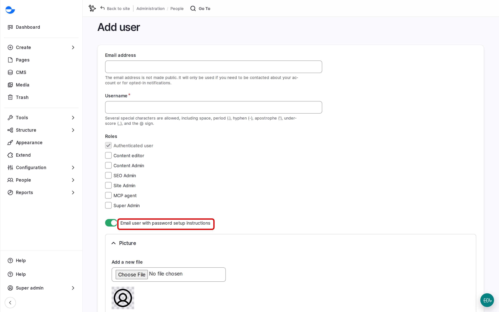

# Add User

This page shows a **Site Admin** or **Super Admin** how to create an account for a new team member.

## Steps

1. Go to **People** and click **Add user** (`/admin/people/create`).
2. Fill in the account details:
   - **Email address** (required): used for password resets and site emails.
   - **Username** (required): the name shown on the content they create. The person can log in with it or with their email address.
   - **Password**: leave empty and tick **Email user with password setup instructions**, so the person chooses their own password.
   - **Status**: **Active**, so they can log in.
   - **Roles**: the role they need, if you can assign it. See [Default Roles and Site Personas](default-roles-and-site-persons/).
3. Optionally, add a **Picture** and choose the **Timezone**.
4. Click **Create new account**.

<figure><figcaption>
Adding a User
</figcaption></figure>

The person receives an email with a link to set their password.


A **Site Admin** sees the **Roles** list only after a **Super Admin** chooses which roles a Site Admin may assign, in **People** \ _**Role assign**_. See [Managing Roles](default-roles-and-site-persons/managing-roles.md). Until then, create the account and ask a **Super Admin** to add the role.


## Tips

- Give each person the smallest role that lets them do their work. Most editors need **Content editor**.
- Use the person's work email address, not a shared one.
- Use a test account, not a real person's, when you need to check what a role sees.
