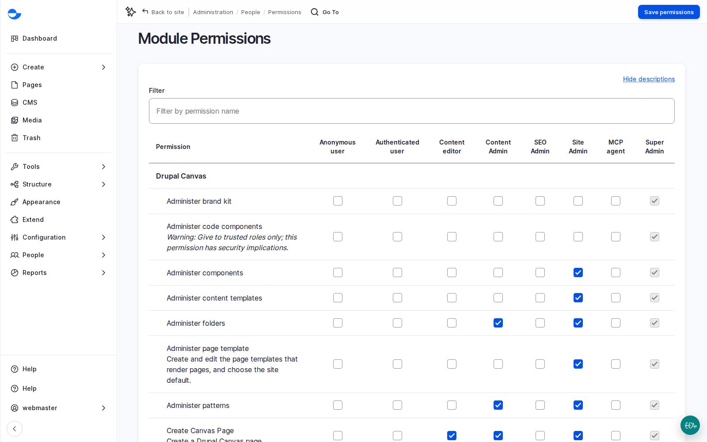

# Build a Role Matrix With a Client

A role matrix shows, on one page, who may do what on the site. It is easier for a client to approve than a list of permissions, and it becomes the basis for testing each role before launch.

## Steps

1. List the people or groups who will use the site, their tasks, the content they own and their languages.
2. Map each group to the closest default role. Most fit exactly. See [Default Roles and Site Personas](default-roles-and-site-persons/).
3. Draw a matrix: roles down the side, main tasks across the top, a tick where a role may do the task.
4. Set up **Role assign** (**People** \ _**Role assign**_) before handover, so the client's **Site Admin** can give roles. Keep **Super Admin** out of the list.
5. Agree how access requests work after launch: who asks, who approves, who grants, and when access ends.

<figure><figcaption>
Drupal Canvas Permissions per Role
</figcaption></figure>

## Questions Clients Ask

- **Can people edit only their own section?** Roles give access by type of content, not by section. Section-level access is possible with extra configuration or modules, but it adds complexity and testing. Raise it early.
- **Do we need a new role?** Only when an existing role with one more permission will not do, such as translators who may only translate. Creating a role is easy; deciding and testing its permissions is the work.
