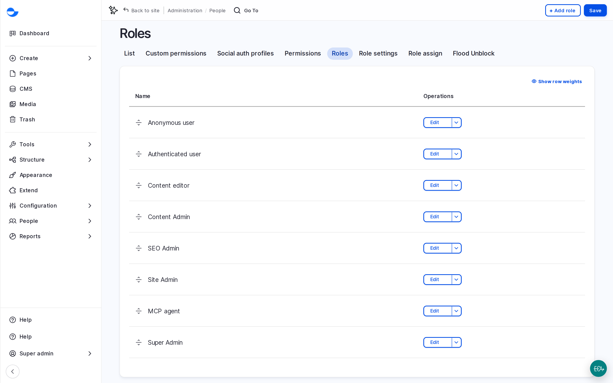

# Default Roles and Site Personas

Varbase ships a role for each kind of person who works on a site. A role is a set of permissions; giving someone a role gives them everything it allows. This page describes each role as it is on a new Varbase site.

## The Roles at a Glance

| Role | For | In short |
| --- | --- | --- |
| **Anonymous user** | Visitors who are not logged in | See published content and fill in public forms. |
| **Authenticated user** | Everyone who is logged in | The base for all other roles. |
| **Content editor** | Writers and editors | Create and edit content, pages and media; publish blog posts and utility pages. |
| **SEO Admin** | Search and marketing specialists | Manage meta tags, URL aliases, redirects and the sitemap. |
| **Content Admin** | Editorial leads | Everything an editor does, plus publish Drupal Canvas pages, manage taxonomies, menus, queues and patterns. |
| **Site Admin** | Site managers | Manage accounts, page and content templates, components, and webform results. |
| **Super Admin** | Technical administrators | Unrestricted access. |

<!-- <figure><figcaption>
The Roles on a Varbase Site
</figcaption></figure> -->

## What Each Role Can Do

### Content Editor

- Create and edit blog posts, utility pages and media.
- Use every workflow step, including **Publish**, on blog posts and utility pages.
- Create and edit Drupal Canvas pages, and delete them, but not publish them.
- Translate content and pages.
- Add terms, edit tags, manage menus and schedule content.
- Restore deleted content and terms from the **Trash**.

### SEO Admin

- Manage meta tag defaults, URL aliases, redirects and the XML sitemap.
- Create, edit and delete blog posts and utility pages, including their SEO fields and the **SEO analysis**.
- Translate content and pages.
- Cannot edit Drupal Canvas pages.

### Content Admin

- Nearly everything a **Content editor** does, except deleting Drupal Canvas pages and some media types.
- Publish Drupal Canvas pages and create patterns.
- Manage taxonomies (including deleting terms) and EntityQueues.
- Edit any webform, and release another editor's content lock.
- Restore deleted media and files from the **Trash**.

### Site Admin

- Everything a **Content Admin** does, plus deleting Drupal Canvas pages, except releasing another editor's content lock.
- Add, edit, block and cancel user accounts, and use **Masquerade** to check what other roles see.
- Edit page templates (header and footer), content templates and the component library.
- Read and export webform submissions.
- Delete items permanently from the **Trash**.

### Super Admin

Has every permission, including adding languages, changing roles and permissions, and site settings. Keep this role for a few trusted technical people.

## Choosing Roles

- Give each person the smallest role that covers their work.
- A person can have more than one role; they get the permissions of all of them.
- Most editors need **Content editor**. Add **SEO Admin** for someone who also manages search settings.

## See Also

- [Managing Roles](managing-roles.md)
