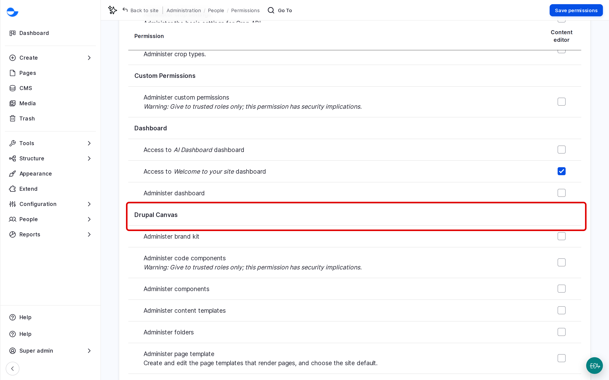
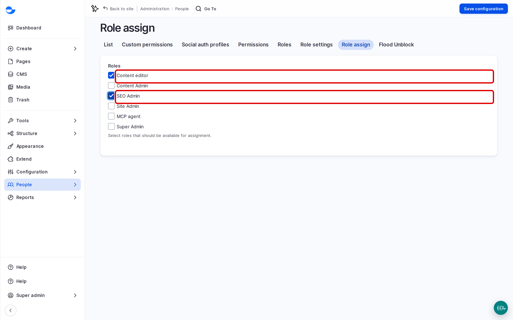

# Managing Roles

Roles and their permissions decide what everyone on the site can do. Changing them is a **Super Admin** task, because one wrong tick can open the site to the wrong people. This page explains where roles are managed and how a **Site Admin** can be allowed to assign some of them.

## The Roles Page

Go to **People** \ **Roles** (`/admin/people/roles`) to see the roles. For each role, **Edit permissions** shows only that role's permissions, which is easier to read than the full list.

## Changing a Role's Permissions

1. On the **Roles** page, open the list next to the role and click **Edit permissions**.
2. Tick or untick permissions. They are grouped by module, for example **Content Moderation** or **Drupal Canvas**.
3. Click **Save permissions**.

<!-- <figure><figcaption>
Editing the Permissions of a Role
</figcaption></figure> -->


Test every change by logging in with a test account that has the role, or with **Masquerade**. Do not test with a real person's account.


## Letting a Site Admin Assign Roles

On a new Varbase site, a **Site Admin** can manage accounts but cannot give anyone a role. A **Super Admin** can allow it for chosen roles:

1. Go to **People** \ **Role assign** (`/admin/people/roleassign`).
2. Tick the roles a **Site Admin** may assign, for example **Content editor** and **SEO Admin**.
3. Click **Save configuration**.

<!-- <figure><figcaption>
Choosing the Roles a Site Admin May Assign
</figcaption></figure> -->

The ticked roles then appear on the account form for a **Site Admin**.

## Adding a Role

1. On the **Roles** page, click **Add role**.
2. Enter the **Role name**, for example "Event editor", and click **Save**.
3. Give it permissions as described above.

Start a new role from the permissions of the closest existing role, and remove what it does not need.

## Tips

- Prefer the default roles; every custom role is one more thing to keep up to date after updates.
- Review the permissions of each role after a Varbase update, since new features can add new permissions.
- Do not remove permissions from **Super Admin**; it is meant to have them all.
