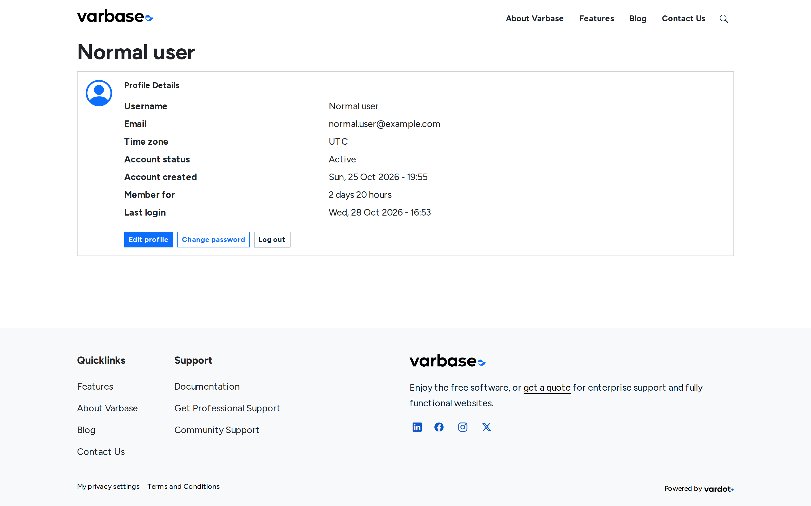
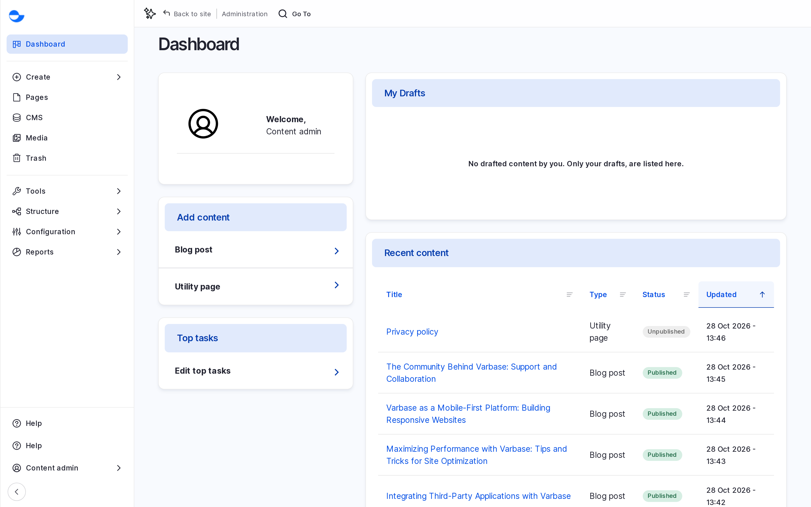
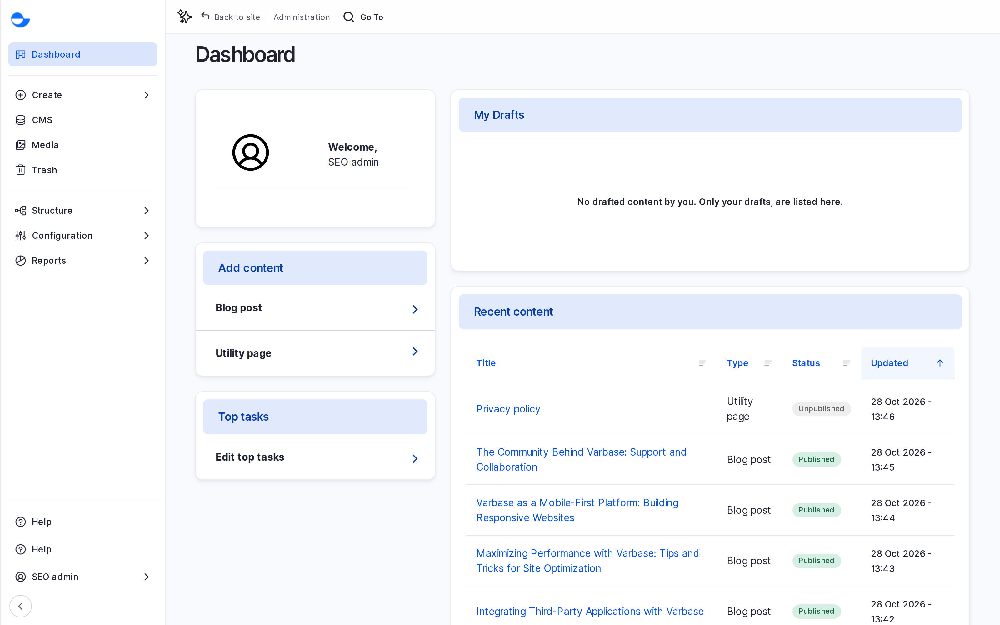
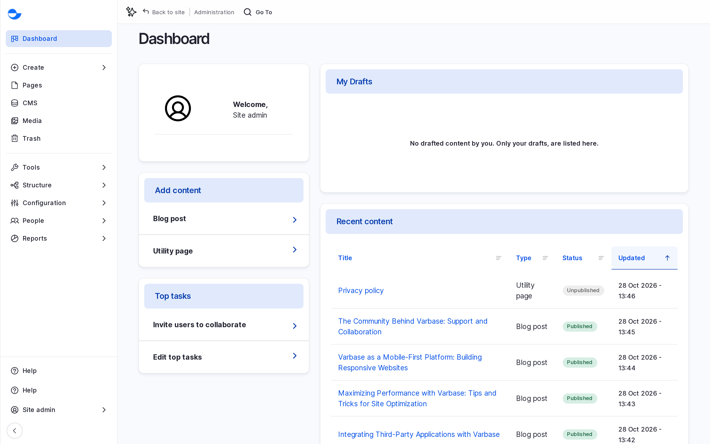
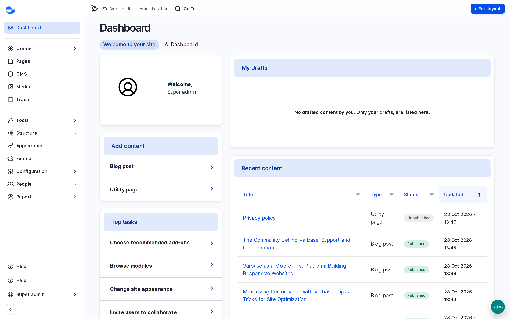

# What Each Role Sees

A Varbase training or demo site has one demo user for each role: **Normal user**, **Content editor**, **Content admin**, **SEO admin**, **Site admin** and **Super admin**. Log in as each one to see how the administration area changes. Your site administrator gives you the demo users' password.


What Each Role Sees (Video)


If the video does not play, open [What Each Role Sees (MP4)](<../../../.gitbook/assets/cd-clip-13-what-each-role-sees.mp4>). Captions: [cd-clip-13-what-each-role-sees.vtt](<../../../.gitbook/assets/cd-clip-13-what-each-role-sees.vtt>).

## What Each Role Can Do

| Task | Normal user | Content editor | Content Admin | SEO Admin | Site Admin | Super Admin |
| --- | --- | --- | --- | --- | --- | --- |
| Create blog posts and utility pages | No | Yes | Yes | Yes | Yes | Yes |
| Publish blog posts and utility pages | No | Yes | Yes | Yes | Yes | Yes |
| Create **Drupal Canvas** pages | No | Yes | Yes | No | Yes | Yes |
| Publish **Drupal Canvas** pages | No | No | Yes | No | Yes | Yes |
| Upload media | No | Yes | Yes | Yes | Yes | Yes |
| Translate content | No | Yes | Yes | Yes | Yes | Yes |
| Use the AI tools in the editor | No | Yes | Yes | Yes | Yes | Yes |
| Manage redirects | No | Yes | Yes | Yes | Yes | Yes |
| Manage meta tags and the sitemap | No | No | No | Yes | No | Yes |
| Manage all webforms | No | No | No | No | Yes | Yes |
| Manage accounts | No | No | No | No | Yes | Yes |
| Assign roles | No | No | No | No | Yes, from the **Role assign** list | Yes |
| Change roles and permissions | No | No | No | No | No | Yes |
| Change site configuration | No | No | No | No | No | Yes |
| Read the site reports | No | Yes | Yes | Yes | Yes | Yes |

A **Site Admin** can give only the roles a **Super Admin** has allowed in **People** \ _**Role assign**_. See [Managing Roles](managing-roles.md).

## The Administration Area by Role

### Normal User

<figure><figcaption>
What the Normal User Sees
</figcaption></figure>

### Content Editor

<figure><figcaption>
What the Content Editor Sees
</figcaption></figure>

### Content Admin

<figure><figcaption>
What the Content Admin Sees
</figcaption></figure>

### SEO Admin

<figure><figcaption>
What the SEO Admin Sees
</figcaption></figure>

### Site Admin

<figure><figcaption>
What the Site Admin Sees
</figcaption></figure>

### Super Admin

<figure><figcaption>
What the Super Admin Sees
</figcaption></figure>

## For QA

- Log in as each demo user and check that the **Navigation** sidebar, the **Dashboard** and the **Create** menu match the figures above.
- As a **Site Admin**, open **Add user**: the **Roles** list shows only the roles set in **Role assign**.
