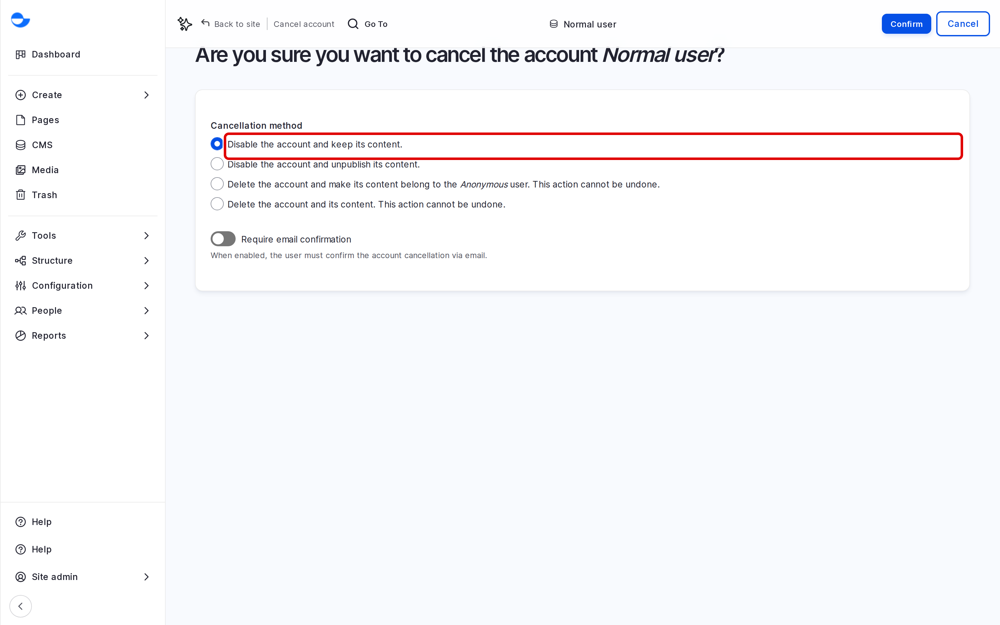

# Delete User

When someone leaves the team, you cancel their account. Varbase lets you choose what happens to the content they created. This page explains the choices.

## Steps

1. Go to **People**, find the account and click **Edit**.
2. At the bottom of the form, click **Cancel account**.
3. Choose what happens to the account and its content:
   - **Disable the account and keep its content.** The person can no longer log in; their content stays as it is. This is the default and the safest choice.
   - **Disable the account and unpublish its content.** As above, and their content is taken off the site.
   - **Delete the account and make its content belong to the Anonymous user.** The account is removed; the content stays, with no author name.
   - **Delete the account and its content.** The account and everything they created are removed.
4. Click **Confirm**.

<figure><figcaption>
Cancelling an Account
</figcaption></figure>


The two **Delete** choices cannot be undone for the account itself. Choose them only when you are sure.


## Cancelling Several Accounts

1. On the **People** list, tick the accounts.
2. In **Action**, choose **Cancel the selected user account(s)** and click **Apply to selected items**.
3. Choose what happens to the content and confirm.

## Who Can Cancel Accounts

A **Site Admin** or **Super Admin**.

## Tips

- Keep at least two **Super Admin** accounts active, so the site is never locked.
- Before deleting an account and its content, check what the person created on the **CMS** list, filtered by author.
