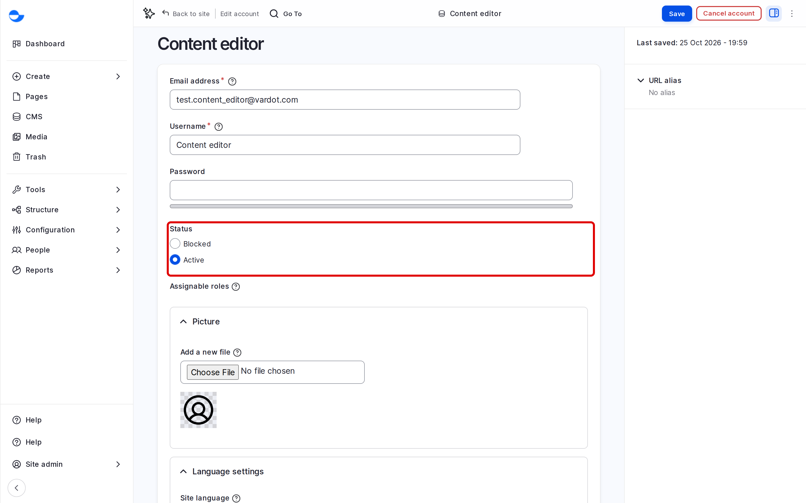

# Edit User

This page shows how to change an account: its details, status, roles and password. A **Site Admin** or **Super Admin** can edit any account; everyone can edit their own.

## Finding the Account

1. Go to **People** (`/admin/people`).
2. Type part of the name or email address in **Name or email contains**, then click **Filter**.
3. Click **Edit** next to the account.

## What You Can Change

- **Email address** and **Username**.
- **Password**: leave empty to keep the current one.
- **Status**: **Blocked** stops the person from logging in, but keeps the account and its content.
- **Roles**: if you can assign roles.
- **Picture**, **Timezone** and the language of the administration screens.

Click **Save** when you finish.

<!-- <figure><figcaption>
Editing an Account
</figcaption></figure> -->

## Common Tasks

### Blocking an Account

Set **Status** to **Blocked** and click **Save**. To block several accounts, tick them on the **People** list, choose **Block the selected user(s)** in **Action**, and click **Apply to selected items**.

### Changing a Role

Tick or untick roles under **Roles** and click **Save**. On the **People** list, the **Action** list also has **Add the ... role** and **Remove the ... role** for several accounts at once.

### Resetting a Password

Ask the person to use **Forgot your password?** on the login page. They get a one-time link and choose a new password, so nobody else knows it. See [Login and Registration](login-and-registration.md).

### Editing Your Own Account

Open your user menu at the bottom of the **Navigation** sidebar and click **Edit profile**. You can change your email address, password, picture and time zone.

## Checking What a Role Sees

A **Site Admin** can use **Masquerade** to browse the site as a test account with another role, then **Unmasquerade** to come back. Use it to check that a role sees what it should.

## Tips

- Block, rather than cancel, the account of someone who leaves for a while.
- Review the **People** list from time to time and block accounts that are no longer used.
