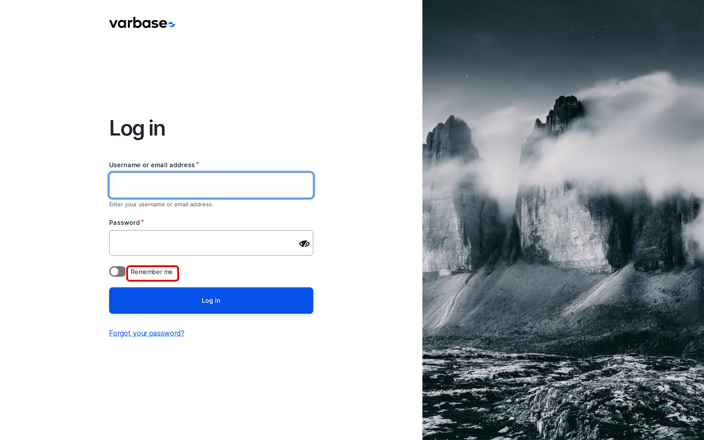

# Login and Registration

This page shows how to log in, stay logged in, and reset a forgotten password, and explains how new accounts are created on a Varbase site.

## Logging In

1. Go to `/user/login`.
2. Enter your **Username or email address** and your **Password**.
3. Tick **Remember me** to stay logged in on this device for up to 30 days. Leave it off on a shared computer.
4. Click **Log in**.

<figure><figcaption>
The Login Form
</figcaption></figure>

Varbase opens your **Dashboard**. See [Dashboard](../dashboard/).

## Resetting a Forgotten Password

1. On the login page, click **Forgot your password?** (`/user/password`).
2. Enter your **Username or email address** and click **Reset**.
3. Open the email from the site and click the one-time link in it.
4. Set a new password.

## Password Rules

A password on a Varbase site must:

- be at least 8 characters long,
- contain an uppercase letter, a lowercase letter, a number and a special character,
- not contain your username.

The form shows which rules your new password meets as you type.

## New Accounts

Visitors cannot create their own accounts on a standard Varbase site: an administrator creates each account. See [Add User](add-user.md). The new user gets an email with a link to set their password.

## Logging Out

Open your user menu at the bottom of the **Navigation** sidebar and click **Log out**.

## Tips

- If a login fails several times in a row, the site blocks further attempts from that account for a while. Wait, or ask a **Site Admin** to unblock it at **People** \ **Flood unblock**.
- Never share your account; ask for your own instead, so every change is recorded under the right name.
