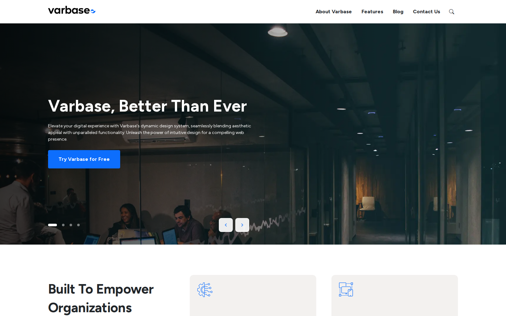
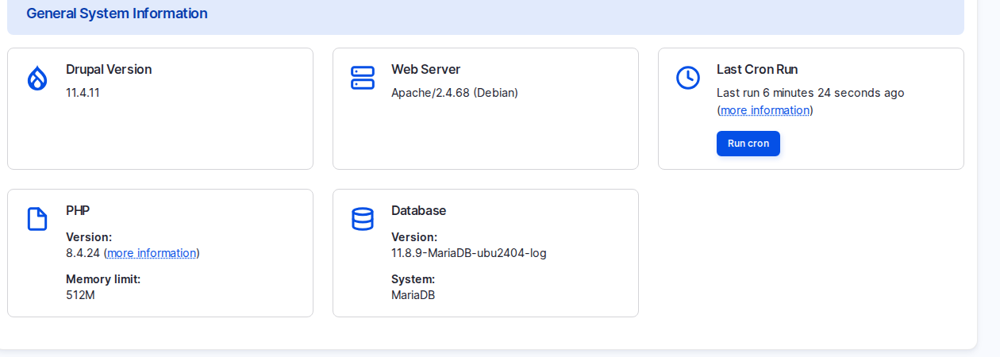

# Varbase in the Drupal World

Clients often ask "is this Drupal?" The answer is yes. This page explains how **Drupal**, **Drupal CMS** and **Varbase** fit together, how to read a version number, and how to plan for releases, security updates and support over the life of a site.


Lesson 1: Varbase in the Drupal World (Video)


## What It Is

A content management system keeps content apart from design, so editors change words and images without touching the look, and it decides who may write, approve and change settings. **Drupal** is a long-standing open-source content management system, made of three kinds of building blocks:

- **Drupal core**: the base every Drupal site shares.
- **Modules**: features on top of core, such as a form builder or a media library.
- **Themes**: how the site looks, for visitors and for editors.

Varbase 11 is best pictured as three layers:

| Layer | What it gives | Who maintains it |
| --- | --- | --- |
| **Drupal core** | The engine: content, users, permissions, languages, APIs. | The Drupal community |
| **Drupal CMS 2** | Recipes for common needs: admin interface, anti-spam, forms, media, privacy, search engines, search, accessibility, AI. | The Drupal CMS initiative |
| **Varbase 11** | Recipes on top: editorial workflow, roles, security hardening, media handling, SEO depth, **Drupal Canvas** page building, the **Vartheme BS5** design system, AI recipes and site templates. | Vardot |

<figure><figcaption>
A Varbase Starter Site as a Visitor Sees It
</figcaption></figure>

Because Varbase uses the Drupal CMS layer rather than replacing it, improvements made by the wider Drupal community reach Varbase sites too. Drupal CMS has its own version numbers: Varbase 11 uses the recipes of Drupal CMS 2, and still runs Drupal 11 underneath.

### Reading a Version Number

Drupal and Varbase versions have three numbers: **major**, **minor** and **patch**.

- **Major** (11): matches the Drupal major version, so Varbase 11 runs on Drupal 11. Moving to a new major version is a planned project.
- **Minor** (11.**4**): new features in a compatible way.
- **Patch** (11.4.**11**): bug fixes and security fixes.

<figure><figcaption>
The Drupal Version in the Status Report
</figcaption></figure>

### Supported Versions and Releases

- **11.0.x** is the current line and the only one that gets new features.
- **10.1.x** receives security and critical fixes only. **10.0.x** and **9.x** are end of life.
- Varbase aims to release about every 2 to 3 weeks. Security releases follow the Drupal security schedule and should be applied within days.
- Updates go to a development copy first, then staging, then production. Never straight to the live site.

See [Release Cycle and Supported Versions](../../overview/release-cycle-and-supported-versions.md) for the current table.

## Why It Matters

- **No lock-in**: it is Drupal and open source, so the client owns the site, its code and its content, and any capable Drupal team can maintain it. This is often a deciding factor in public-sector procurement.
- **Plannable support**: a steady release rhythm lets you budget regular small updates instead of rare large ones.
- **The right line**: a new project on 11.0.x is on the line that gets new features, including the AI work.

## Scenario: Answer "Which Version Is This Site On?"

You take over an existing Varbase site and need to know whether it still gets security fixes.

1. Log in as a **Super Admin**. Other roles cannot open this report.
2. Go to **Reports** \ _**Status report**_ (`/admin/reports/status`).
3. Read **Drupal Version** in **General System Information**. On the studio site it is 11.4.11.
4. Compare the Varbase line of the project with [Release Cycle and Supported Versions](../../overview/release-cycle-and-supported-versions.md).
5. If the site is on an end-of-life line, plan the upgrade as a project with the development team.

## Scenario: Show What Recipes Already Did

Recipes are tested setup steps that are applied once. You can show their effect on any Varbase site:

1. Go to `/admin/config/content/honeypot`: **Honeypot**, from the Drupal CMS anti-spam recipe, already protects every form with a hidden field that spam robots fill in.
2. Go to `/admin/config/user-interface/antibot`: **Antibot**, from the Varbase security recipe, checks that a real browser sends each form.
3. On the **Dashboard**, the **Top tasks** block and **Choose recommended add-ons** (the **Project Browser**) come from Drupal CMS.

Nobody on the project had to choose these modules or decide their settings. See [How Varbase Is Built](../how-varbase-is-built/) for recipes in detail.

## When to Choose Drupal CMS or Varbase

Both are open source, both use recipes, and both can run the Vardot site templates.

- **Drupal CMS** fits a simpler site run by a small team.
- **Varbase** fits a site with a real editorial team, several roles, strict security or accessibility needs, several languages, or plans for AI with controls around it.

Ask how the client's team will work on the site every day; the answer usually points to one or the other.

## Questions Clients Ask

- **Is Varbase a fork of Drupal?** No. It is Drupal core plus contributed modules and recipes. Nothing is forked.
- **We are on Varbase 9 or 10. Do we have to rebuild?** Moving to 11 is an upgrade project, not a rebuild by default. The content is kept; configuration, custom code and the theme need checking. 9.x and 10.0.x are end of life, so plan it.
- **What happens when Drupal 12 arrives?** A future Varbase major version will track it. Until then, 11.0.x is the line to be on.

## Planning Notes

- Budget a recurring maintenance slot for the release rhythm. Assumption: about half a day per release for update, test and deploy on a typical site, with AI-assisted testing.
- In proposals, name the product and its version (for example Varbase 11 on Drupal 11), so nobody is confused later.
- For an upgrade from 9.x or 10.x, run a discovery on custom modules and layouts first. Layout Builder pages do not turn into Drupal Canvas pages by themselves.
- Agree in the contract who applies security updates and how quickly.

## Where to Get Help

- **Community**: the Varbase issue queue on drupal.org for bugs and feature requests (search it first), the Varbase Slack for quick questions, and the Vardot GitHub organisation for the code.
- **Professional**: support, consulting and training from Vardot. See [How to Get Support](../../overview/how-to-get-support.md).
- **Security problems** are never reported in public. They go through the Drupal security team's private process.


**Check Yourself**

1. How would you explain the difference between Drupal CMS and Varbase to a client in two sentences?
2. What does the first number of a Varbase version tell you?
3. Where would you check whether a site's version still receives security fixes?

