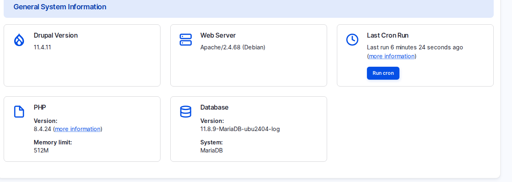

# Check Which Version a Site Is On

When you take over an existing Varbase site, the first question is whether it still gets security fixes. The **Status report** answers it in a minute.

## Steps

1. Log in as a **Super Admin**. Other roles cannot open this report.
2. Go to **Reports** \ _**Status report**_ (`/admin/reports/status`).
3. Read **Drupal Version** in **General System Information**. On the studio site it is 11.4.11.
4. Compare the Varbase line of the project with [Release Cycle and Supported Versions](../../overview/release-cycle-and-supported-versions.md).
5. If the site is on an end-of-life line, plan the upgrade as a project with the development team.

<figure><figcaption>
The Drupal Version in the Status Report
</figcaption></figure>

## Questions Clients Ask

- **We are on Varbase 9 or 10. Do we have to rebuild?** Moving to 11 is an upgrade project, not a rebuild by default. The content is kept; configuration, custom code and the theme need checking. 9.x and 10.0.x are end of life, so plan it.

## Planning Notes

- For an upgrade from 9.x or 10.x, run a discovery on custom modules and layouts first. Layout Builder pages do not turn into Drupal Canvas pages by themselves.
- Agree in the contract who applies security updates and how quickly.
