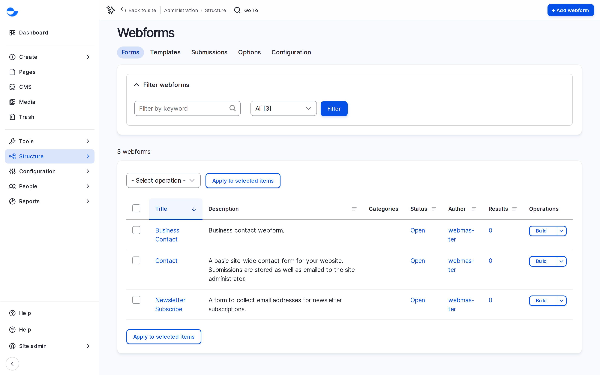
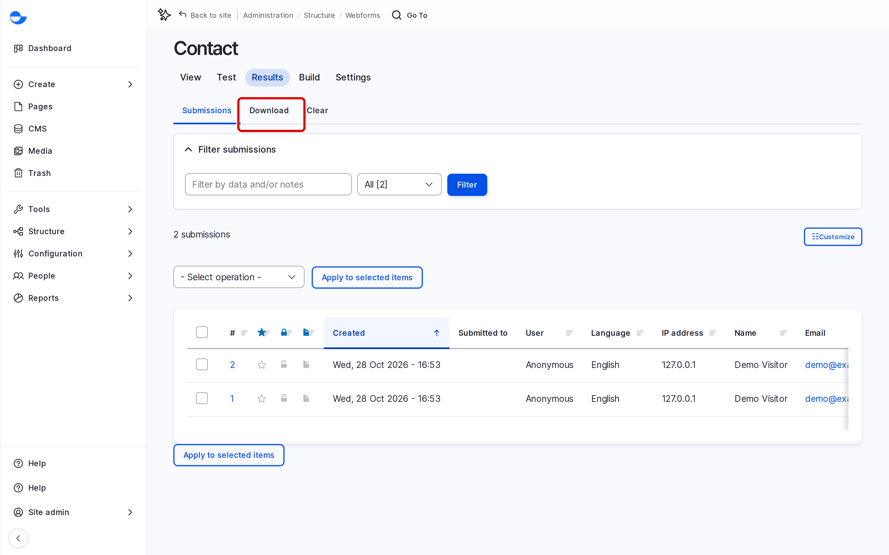

# Webforms

Webforms are the forms visitors fill in on your site: contact, feedback, registration, newsletter sign-up. You build them in the browser, choose who is emailed when someone submits one, and read the submissions in one place. This section shows how.

## Forms on a Varbase Site

A new site has ready forms, such as **Contact**, **Business Contact** and **Newsletter Subscribe**, and a set of templates to start new forms from: **Contact Us**, **Feedback**, **Registration**, **Job Application**, **Subscribe**, **Session Evaluation** and more.

Go to **Structure** \ **Webforms** (`/admin/structure/webform`) to see them.

<!-- <figure><figcaption>
The Webforms List
</figcaption></figure> -->

Each form has tabs: **View** (the form as visitors see it), **Test**, **Results**, **Build**, **Settings** and **Export**.

## Showing a Form on a Page

- **Its own page**: every form has an address such as `/form/contact`.
- **In a Drupal Canvas page**: add the **Webform** component from the **Library** and choose the form in its settings. See [Adding and Arranging Components](../building-pages-with-drupal-canvas/adding-and-arranging-components.md).
- **On every page**: a **Site Admin** can add the **Webform** component to the footer of the page template, for example for a newsletter sign-up. See [Page Templates](../building-pages-with-drupal-canvas/page-templates.md).

## Reading Submissions

1. On the webforms list, click **Results** next to the form.
2. Click a submission to read it.
3. Click **Download** to export all submissions, for example as a CSV file for a spreadsheet.

<!-- <figure><figcaption>
Webform Submissions
</figcaption></figure> -->

## Who Can Do What

| Task | Content editor | Content Admin | Site Admin |
| --- | --- | --- | --- |
| Create forms | Yes | Yes | Yes |
| Edit forms | Their own | Any | Any |
| Read and export submissions | No | No | Yes |

A **Super Admin** can do all of these. Submissions hold visitors' personal details, so keep access to them narrow.

## In This Section

- [Create New Webform](create-new-webform.md)
- [Setting up Email Handlers](setting-up-email-handlers.md)
