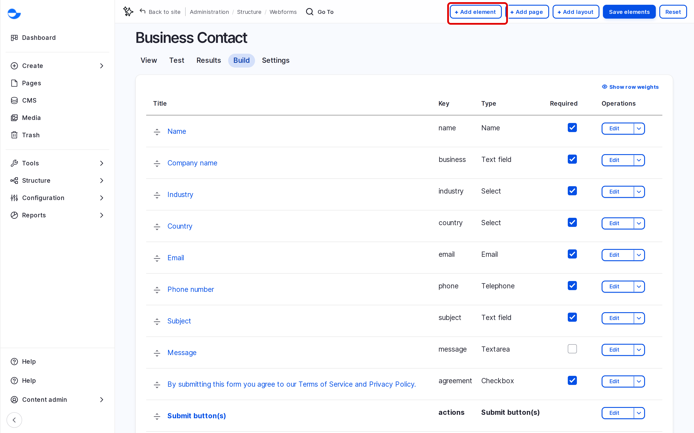

# Create New Webform

This page shows how to create a form, from a template or from scratch, add fields, and test it before visitors use it.

## Starting From a Template

1. Go to **Structure** \ **Webforms** and open the **Templates** tab (`/admin/structure/webform/templates`).
2. Find a template, for example **Contact Us**, and click **Select**.
3. Enter the **Title** of your form, and click **Save**.

<!-- <figure><figcaption>
Choosing a Webform Template
</figcaption></figure> -->

The new form has the template's fields and emails, ready to change.

## Starting From Scratch

1. Go to **Structure** \ **Webforms** and click **Add webform**.
2. Enter the **Title** and, optionally, an **Administrative description**.
3. Click **Save**.

## Adding Fields

1. On the form's **Build** tab, click **Add element**.
2. Search for or choose the field type, such as **Text field**, **Email**, **Select** or **Checkboxes**.
3. Fill in the **Title** (the label visitors see), and tick **Required** if it must be filled in.
4. Click **Save**.
5. Drag the fields into order, then click **Save elements**.

<!-- <figure><figcaption>
Building the Form
</figcaption></figure> -->

## Main Settings

On the **Settings** tab you can change, among others:

- **General**: open or close the form.
- **Form**: the submit button label.
- **Confirmation**: the message or page visitors see after submitting.
- **Emails / Handlers**: who is emailed. See [Setting up Email Handlers](setting-up-email-handlers.md).

## Testing the Form

1. Open the **Test** tab, fill in the form and submit it.
2. Check the confirmation, and the emails if any are set up.
3. Ask a **Site Admin** to check the test submission under **Results** and delete it.

## Tips

- Ask only for what you need; every extra field loses some visitors.
- Write labels as plain questions, and use **Description** for help text.
- Do not use the placeholder text as the only label; screen readers may not read it.
- Close a form when a campaign or event is over, rather than deleting it and its results.
