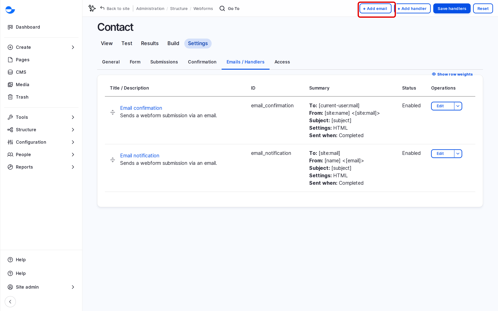
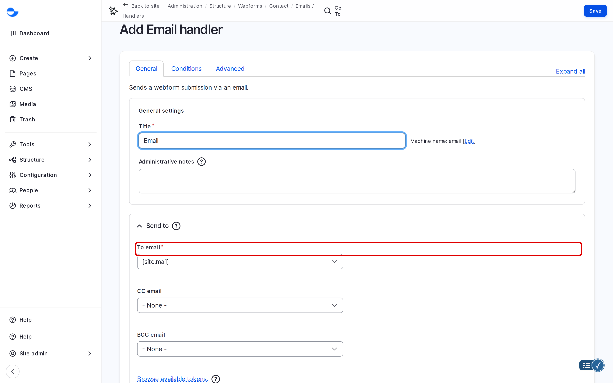

# Setting up Email Handlers

An email handler sends an email each time someone submits a form, for example to your team, or a confirmation to the visitor. This page shows how to add and test one.

## Opening the Handlers

1. Go to **Structure** \ **Webforms**.
2. Open the form, click **Settings**, then **Emails / Handlers**.

Forms made from a template already have handlers, usually an **Email notification** to your team and an **Email confirmation** to the visitor.

<!-- <figure><figcaption>
The Handlers of a Webform
</figcaption></figure> -->

## Adding an Email

1. Click **Add email**.
2. Fill in the main settings:
   - **To email**: the address that receives the email. To email the visitor, choose the form's **Email** field instead of typing an address.
   - **From email** and **From name**: who the email comes from, for example "Example website".
   - **Reply-to email**: choose the form's **Email** field, so replying goes to the visitor.
   - **Subject**: for example "New contact form submission".
   - **Body**: keep **Default** to include every answer, or write your own text.
3. Click **Save**.

<!-- <figure><figcaption>
Setting Up an Email
</figcaption></figure> -->

## Testing the Emails

1. Open the form's **Test** tab and submit it with your own email address.
2. Check that each email arrives, with the right subject and answers.
3. Reply to the notification to check the reply goes to the address you entered.

## If Emails Do Not Arrive

- Check the spam folder.
- Check the addresses in the handler for typing mistakes.
- Ask your site administrator to check the site's email setup.

## Tips

- Send notifications to a shared team mailbox rather than to one person.
- Keep confirmation emails short: thank the visitor and say when they will hear back.
- After adding a field to the form, check that the email still includes it.
